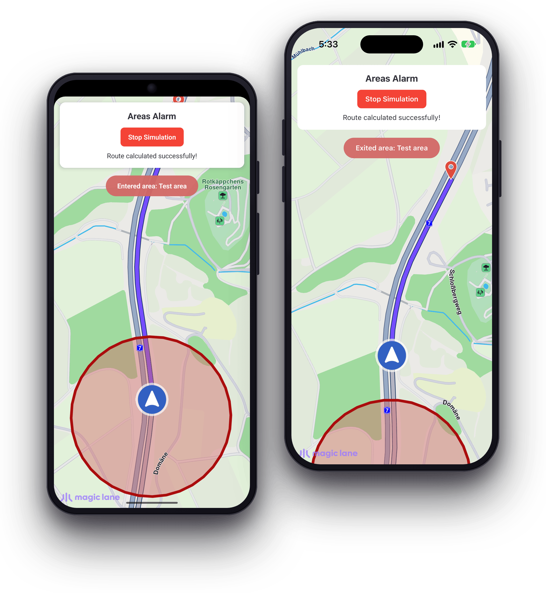

# Areas Alarm (React Native)

A circular area is drawn on the map; a route is calculated through it; during a
simulated drive the app is notified when the vehicle enters and exits the area.



## What it demonstrates

- Drawing a circular area as a polygon `MarkerCollection` with a translucent
  `polygonFillColor`.
- Monitoring a `CircleGeographicArea` with `AlarmService` /
  `AlarmListener.create({ onBoundaryCrossed })` to receive enter/exit events.
- Routing with `RoutingService.calculateRoute` and simulating the drive with
  `NavigationService.startSimulation`, following the position with
  `map.startFollowingPosition`.

The SDK calls are identical to the web example; the only platform difference is
that the map is hosted by the `<GLView>` component instead of a DOM element, and
the buttons plus the enter/exit notification banner are a React Native overlay.

## API token

The map renders without a token (with a watermark). A token from
[developer.magiclane.com](https://developer.magiclane.com) removes it. Set it in
`App.tsx`:

```ts
const GEMKIT_TOKEN = '<your token>';
```

## Run

Install dependencies first:

```sh
npm install
```

### Android

```sh
npm run android
```

The app is built for the `arm64-v8a` architecture.

To run it on an emulator on a computer with an Intel or AMD processor, which
uses x86_64 system images, add `"x86_64"` to `abiFilters` in
`android/app/build.gradle`:

```groovy
abiFilters "arm64-v8a", "x86_64"
```

### iOS

```sh
cd ios && bundle install && LANG=en_US.UTF-8 LC_ALL=en_US.UTF-8 bundle exec pod install && cd ..
npm run ios
```

## Notes

- The monitored area and the departure/destination coordinates are hard-coded
  (near Bad Hersfeld, Germany). Change them in `App.tsx` to try another location.
