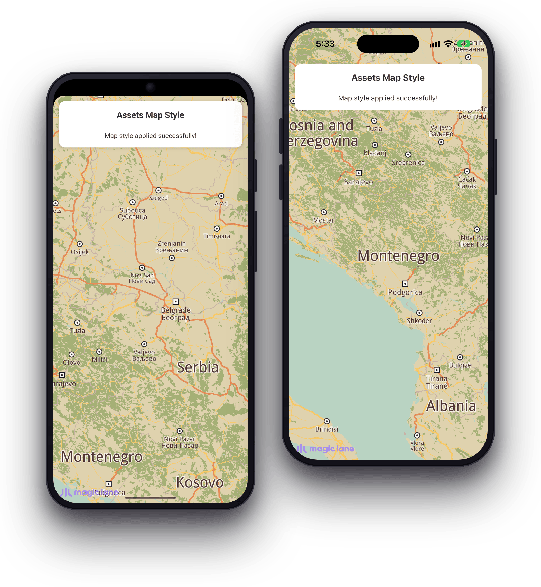

# Assets Map Style (React Native)

This app applies a map style (`.style`) shipped as an app asset and re-centers
the map once the style is live.



## What it demonstrates

- Applying a style from raw bytes with `map.preferences.setMapStyleByBuffer`.
- Being notified when the style changes via `map.registerSetMapStyleCallback`, then
  re-centering with `map.centerOnCoordinates`.

The SDK usage is the same as on the web; the only platform difference is that the
map is hosted by `<GLView>` and the trigger is a `<TouchableOpacity>`.

## How the style asset is bundled

The style file is `assets/Basic_1_Oldtime-1_21_656.style`.

The web demo does `fetch('./file.style')` to obtain an `ArrayBuffer`. React Native
cannot read the bytes of a bundled binary asset without a file-system module, so
the style also ships as a generated TypeScript module,
`assets/basicOldtimeStyle.ts`, whose default export is the file's contents as a
base64 string. Metro bundles it like any other source file. `loadStyleBuffer()` in
`App.tsx` decodes it back into a `Uint8Array` with `atob` (provided by Hermes) and
passes it to `setMapStyleByBuffer`. No extra dependency or native setup is needed.

If you replace or update the `.style` file, regenerate the module from the app
folder with the command from the header comment of `basicOldtimeStyle.ts`:

```sh
node -e "process.stdout.write('export default ' + JSON.stringify(require('fs').readFileSync('assets/Basic_1_Oldtime-1_21_656.style').toString('base64')) + ';\\n')" > assets/basicOldtimeStyle.ts
```

The command writes only the `export default` line, so add the header comment back
afterwards if you want to keep it.

## API token

The map renders without a token (with a watermark). A token from
[developer.magiclane.com](https://developer.magiclane.com) removes it. Set it in
`App.tsx`:

```ts
const GEMKIT_TOKEN = '<your token>';
```

## Run

Install dependencies first:

```sh
npm install
```

### Android

```sh
npm run android
```

The app is built for the `arm64-v8a` architecture.

To run it on an emulator on a computer with an Intel or AMD processor, which
uses x86_64 system images, add `"x86_64"` to `abiFilters` in
`android/app/build.gradle`:

```groovy
abiFilters "arm64-v8a", "x86_64"
```

### iOS

```sh
cd ios && bundle install && LANG=en_US.UTF-8 LC_ALL=en_US.UTF-8 bundle exec pod install && cd ..
npm run ios
```
