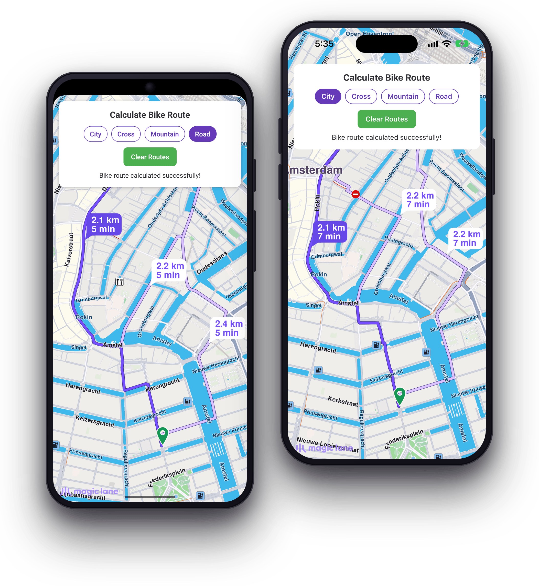

# Calculate Bike Route (React Native)

This app calculates a bike route in Amsterdam using a selectable electric-bike
profile (City / Cross / Mountain / Road) and draws the alternatives on the map.



## What it demonstrates

- Configuring a bike route with
  `new RoutePreferences({ transportMode: RouteTransportMode.bicycle, bikeProfile: new BikeProfileElectricBikeProfile({ profile }) })`
  and the `BikeProfile` enum (`city`, `cross`, `mountain`, `road`). The
  transport mode defaults to `car`, so without `RouteTransportMode.bicycle` the
  route is calculated for a car.
- Calculating / cancelling a route with `RoutingService.calculateRoute` and
  `RoutingService.cancelRoute`.
- Displaying routes with `map.preferences.routes.add(...)` and framing them with
  `map.centerOnRoutes({ routes })`.
- Selecting an alternative route by tapping it on the map.

The SDK calls are those of the web example, plus the bicycle transport mode. The
only platform difference is that the map is hosted by the `<GLView>` component
instead of a DOM element. The web demo's dropdown menu becomes a row of profile
chips.

## API token

The map renders without a token (with a watermark). A token from
[developer.magiclane.com](https://developer.magiclane.com) removes the watermark
and unlocks full functionality. Set it in `App.tsx`:

```ts
const GEMKIT_TOKEN = '<your token>';
```

## Run

Install dependencies first:

```sh
npm install
```

### Android

```sh
npm run android
```

The app is built for the `arm64-v8a` architecture.

To run it on an emulator on a computer with an Intel or AMD processor, which
uses x86_64 system images, add `"x86_64"` to `abiFilters` in
`android/app/build.gradle`:

```groovy
abiFilters "arm64-v8a", "x86_64"
```

### iOS

```sh
cd ios && bundle install && LANG=en_US.UTF-8 LC_ALL=en_US.UTF-8 bundle exec pod install && cd ..
npm run ios
```

## Notes

- `GLView` fills the whole window; the controls float on top inside a
  `SafeAreaView` with `pointerEvents="box-none"`.
- Pick a profile chip before building the route to see how the geometry changes.
