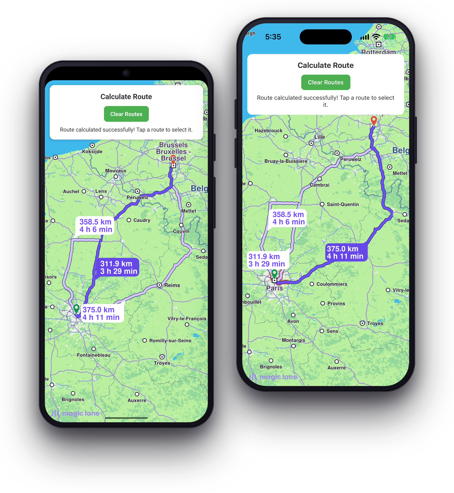

# Calculate Route (React Native)

This app calculates a route between two fixed points (Paris → Brussels), draws
the alternatives on the map with distance / duration labels, and lets you tap an
alternative to promote it to the main route.



## What it demonstrates

- Building departure / destination landmarks with
  `Landmark.withLatLng({ latitude, longitude })`.
- Calculating a route with `RoutingService.calculateRoute(waypoints, prefs, cb)`
  and cancelling it with `RoutingService.cancelRoute(handler)`.
- Displaying routes with `map.preferences.routes.add(route, isMain, { label })`
  and framing them with `map.centerOnRoutes({ routes })`.
- Selecting an alternative route via `registerTouchCallback` /
  `setCursorScreenPosition` / `cursorSelectionRoutes` and assigning
  `routes.mainRoute`.

The SDK calls are identical to the web example; the only platform difference is
that the map is hosted by the `<GLView>` component instead of a DOM element.

## API token

The map renders without a token (with a watermark). A token from
[developer.magiclane.com](https://developer.magiclane.com) removes the watermark
and unlocks full functionality. Set it in `App.tsx`:

```ts
const GEMKIT_TOKEN = '<your token>';
```

## Run

Install dependencies first:

```sh
npm install
```

### Android

```sh
npm run android
```

The app is built for the `arm64-v8a` architecture.

To run it on an emulator on a computer with an Intel or AMD processor, which
uses x86_64 system images, add `"x86_64"` to `abiFilters` in
`android/app/build.gradle`:

```groovy
abiFilters "arm64-v8a", "x86_64"
```

### iOS

```sh
cd ios && bundle install && LANG=en_US.UTF-8 LC_ALL=en_US.UTF-8 bundle exec pod install && cd ..
npm run ios
```

## Notes

- `GLView` fills the whole window (`StyleSheet.absoluteFill`), so its size is
  final from the first render; the controls float on top inside a `SafeAreaView`
  with `pointerEvents="box-none"`. On Android, a map whose size changes after it
  is created stops drawing (Magic Lane engine 0.2.0).
- Change `DEPARTURE` / `DESTINATION` in `App.tsx` to try other endpoints.
