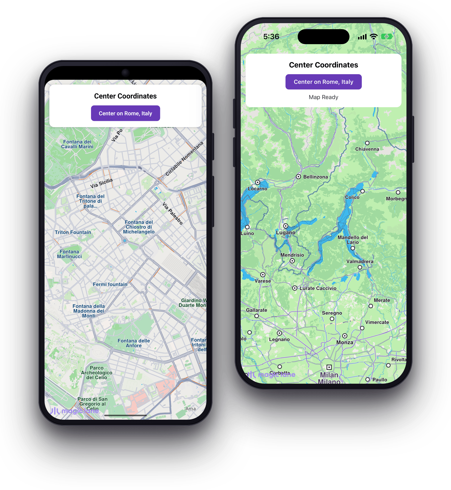

# Center Coordinates (React Native)

This app shows a map and centers it on Rome, Italy at the press of a button.



## What it demonstrates

- Zero-touch SDK initialization and map hosting with the `<GLView>` component.
- Centering the map on a coordinate at a given zoom level with
  `gemMap.centerOnCoordinates(coords, { zoomLevel: 60 })`.

The SDK usage is the same as on the web; the only platform difference is that the
map is hosted by `<GLView>` instead of a DOM element. Passing `apiToken` to
`<GLView>` initializes the SDK, so no explicit `GemKit.initialize` call is needed.

## API token

The map renders without a token (with a watermark). A token from
[developer.magiclane.com](https://developer.magiclane.com) removes it. Set it in
`App.tsx`:

```ts
const GEMKIT_TOKEN = '<your token>';
```

## Run

Install dependencies first:

```sh
npm install
```

### Android

```sh
npm run android
```

The app is built for the `arm64-v8a` architecture.

To run it on an emulator on a computer with an Intel or AMD processor, which
uses x86_64 system images, add `"x86_64"` to `abiFilters` in
`android/app/build.gradle`:

```groovy
abiFilters "arm64-v8a", "x86_64"
```

### iOS

```sh
cd ios && bundle install && LANG=en_US.UTF-8 LC_ALL=en_US.UTF-8 bundle exec pod install && cd ..
npm run ios
```
