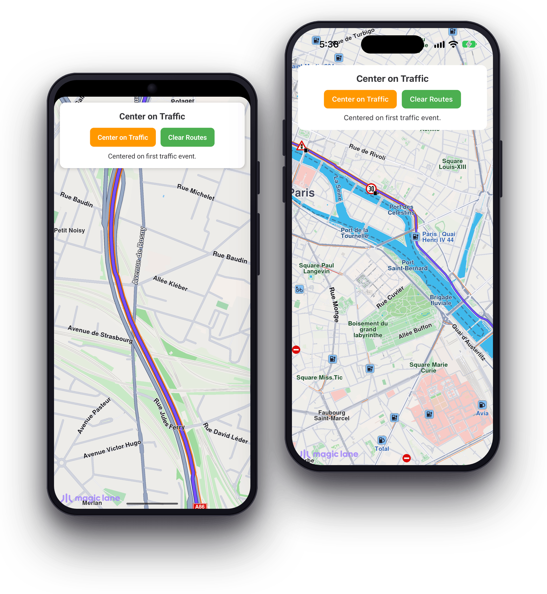

# Center on Traffic (React Native)

This app builds a Paris → Brussels route and centers the camera on the route's
first traffic event.



## What it demonstrates

- Calculating a route with `RoutingService.calculateRoute` (and cancelling it with
  `RoutingService.cancelRoute`).
- Adding the route to the map (`map.preferences.routes.add`) and framing it with
  `map.centerOnRoute`.
- Reading `route.trafficEvents` and centering on one with
  `map.centerOnRouteTrafficEvent`.

The SDK usage is the same as on the web; the only platform difference is that the
map is hosted by `<GLView>` and the controls are React Native buttons.

## API token

The map renders without a token (with a watermark). A token from
[developer.magiclane.com](https://developer.magiclane.com) removes it. Set it in
`App.tsx`:

```ts
const GEMKIT_TOKEN = '<your token>';
```

## Notes

- Traffic events require live traffic data, which needs an internet connection and a
  valid token. Without traffic on the route, the app reports "No traffic events
  found."

## Run

Install dependencies first:

```sh
npm install
```

### Android

```sh
npm run android
```

The app is built for the `arm64-v8a` architecture.

To run it on an emulator on a computer with an Intel or AMD processor, which
uses x86_64 system images, add `"x86_64"` to `abiFilters` in
`android/app/build.gradle`:

```groovy
abiFilters "arm64-v8a", "x86_64"
```

### iOS

```sh
cd ios && bundle install && LANG=en_US.UTF-8 LC_ALL=en_US.UTF-8 bundle exec pod install && cd ..
npm run ios
```
