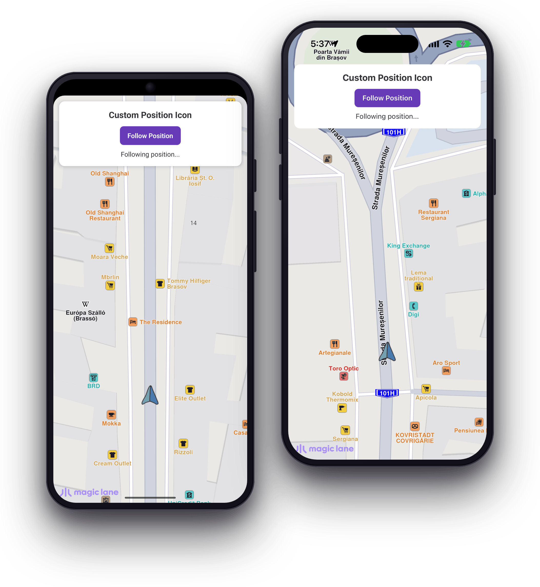

# Custom Position Icon (React Native)

The default position tracker is replaced with a custom arrow icon, then the
camera follows the device's live position.



## What it demonstrates

- Replacing the position tracker artwork with
  `MapSceneObject.customizeDefPositionTracker(bytes, SceneObjectFileFormat.tex)`
  and scaling it via `MapSceneObject.getDefPositionTracker().scale`.
- Requesting location permission (`PositionService.requestLocationPermission`),
  switching to the live GPS source (`PositionService.instance.setLiveDataSource`),
  and following it with `map.startFollowingPosition({ animation, viewAngle })`.

The SDK calls are identical to the web example; the only platform difference is
that the map is hosted by the `<GLView>` component instead of a DOM element.

## Asset note

The web demo fetches the custom arrow (`navArrow.png`) from the Vite `public`
folder, which has no React Native equivalent (no dev web server). The same 48×48
PNG is therefore embedded in `App.tsx` as base64 and decoded to a byte array at
runtime, so the example is self-contained. To use your own icon, replace the
embedded base64 (or load bundled asset bytes via a native module /
`react-native-fs`).

## API token

The map renders without a token (with a watermark). A token from
[developer.magiclane.com](https://developer.magiclane.com) removes it. Set it in
`App.tsx`:

```ts
const GEMKIT_TOKEN = '<your token>';
```

## Run

Install dependencies first:

```sh
npm install
```

### Android

```sh
npm run android
```

The app is built for the `arm64-v8a` architecture.

To run it on an emulator on a computer with an Intel or AMD processor, which
uses x86_64 system images, add `"x86_64"` to `abiFilters` in
`android/app/build.gradle`:

```groovy
abiFilters "arm64-v8a", "x86_64"
```

### iOS

```sh
cd ios && bundle install && LANG=en_US.UTF-8 LC_ALL=en_US.UTF-8 bundle exec pod install && cd ..
npm run ios
```

## Notes

- Following the position requires a location permission and a GPS fix; on the
  simulator/emulator, set a mock location for the arrow to move.
