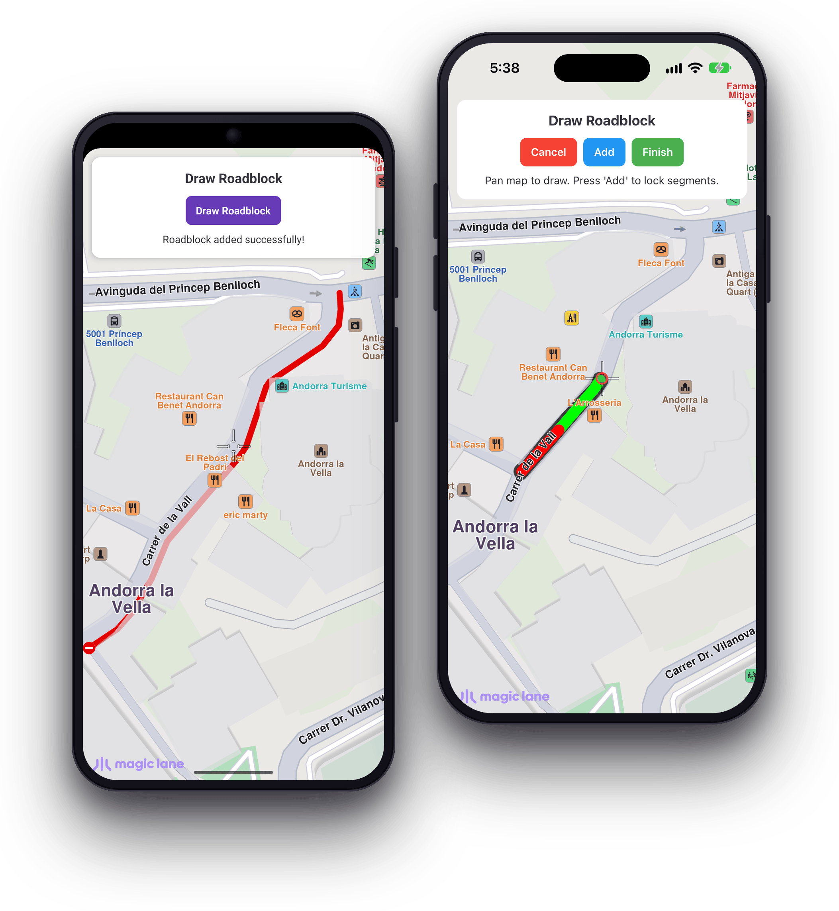

# Draw Roadblock (React Native)

The map center acts as a "pen": pan the map to trace a road-snapped path, lock
segments with "Add", then commit a persistent user roadblock with "Finish".
The pen only snaps within 10 m of a road cars may use, so the sample starts
zoomed in on a street in Andorra la Vella.



## What it demonstrates

- Previewing a road-snapped path between successive points with
  `TrafficService.getPersistentRoadblockPathPreview` (seeded with
  `UserRoadblockPathPreviewCoordinate.fromCoordinates`).
- Drawing the preview (green) and locked (red) paths with
  `map.preferences.paths.add(Path.fromCoordinates(...), { colorInner, szInner })`.
- Committing the roadblock with
  `TrafficService.addPersistentRoadblockByCoordinates` (which returns a `Pair`;
  read `.second` for the `GemError`).
- Driving the preview off the map-move callback (`map.registerMoveCallback`) using
  the map center (`map.transformScreenToWgs` of the viewport centre).

The SDK calls are identical to the web example; the only platform difference is
that the map is hosted by the `<GLView>` component instead of a DOM element, the
controls are a React Native overlay, and a center crosshair marks the "pen".

## API token

The map renders without a token (with a watermark). A token from
[developer.magiclane.com](https://developer.magiclane.com) removes it. Set it in
`App.tsx`:

```ts
const GEMKIT_TOKEN = '<your token>';
```

## Run

Install dependencies first:

```sh
npm install
```

### Android

```sh
npm run android
```

The app is built for the `arm64-v8a` architecture.

To run it on an emulator on a computer with an Intel or AMD processor, which
uses x86_64 system images, add `"x86_64"` to `abiFilters` in
`android/app/build.gradle`:

```groovy
abiFilters "arm64-v8a", "x86_64"
```

### iOS

```sh
cd ios && bundle install && LANG=en_US.UTF-8 LC_ALL=en_US.UTF-8 bundle exec pod install && cd ..
npm run ios
```
