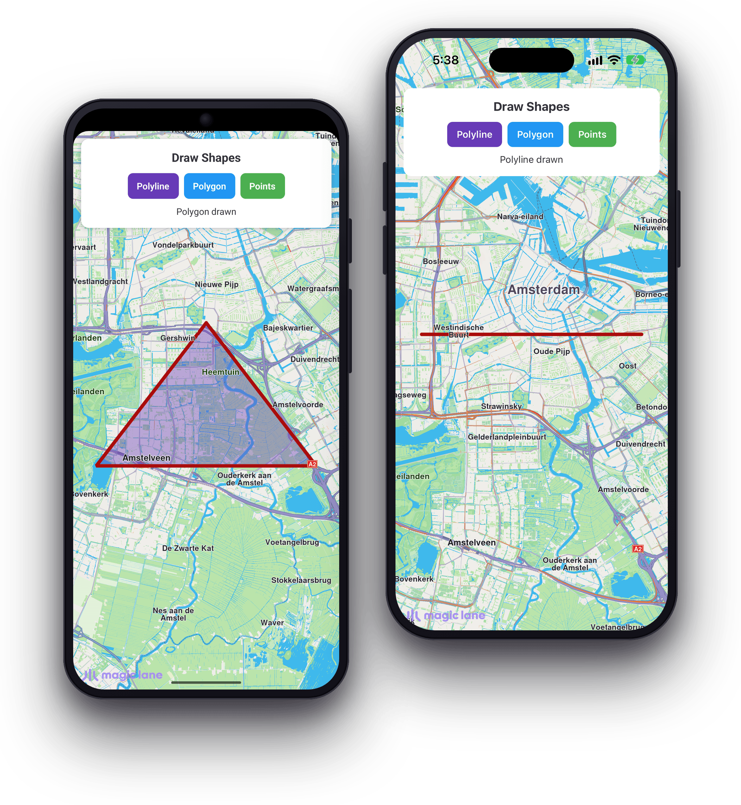

# Draw Shapes (React Native)

Three buttons draw a polyline, a polygon, or a set of points on the map from a
`MarkerCollection`, then frame the drawn shape.



## What it demonstrates

- Building geometry with `MarkerCollection.create(MarkerType.Polyline | Polygon
  | Point, name)` and `Marker.setCoordinates([...])`.
- Rendering it with `map.preferences.markers.add(collection, { settings })` and a
  `MarkerCollectionRenderSettings`.
- Clearing previous shapes (`markers.clear()`) and centering the camera with
  `map.centerOnArea(collection.area, { zoomLevel })`.

The SDK calls are identical to the web example; the only platform difference is
that the map is hosted by the `<GLView>` component instead of a DOM element, and
the buttons are React Native `<TouchableOpacity>` controls over the full-window
map.

## API token

The map renders without a token (with a watermark). A token from
[developer.magiclane.com](https://developer.magiclane.com) removes it. Set it in
`App.tsx`:

```ts
const GEMKIT_TOKEN = '<your token>';
```

## Run

Install dependencies first:

```sh
npm install
```

### Android

```sh
npm run android
```

The app is built for the `arm64-v8a` architecture.

To run it on an emulator on a computer with an Intel or AMD processor, which
uses x86_64 system images, add `"x86_64"` to `abiFilters` in
`android/app/build.gradle`:

```groovy
abiFilters "arm64-v8a", "x86_64"
```

### iOS

```sh
cd ios && bundle install && LANG=en_US.UTF-8 LC_ALL=en_US.UTF-8 bundle exec pod install && cd ..
npm run ios
```
