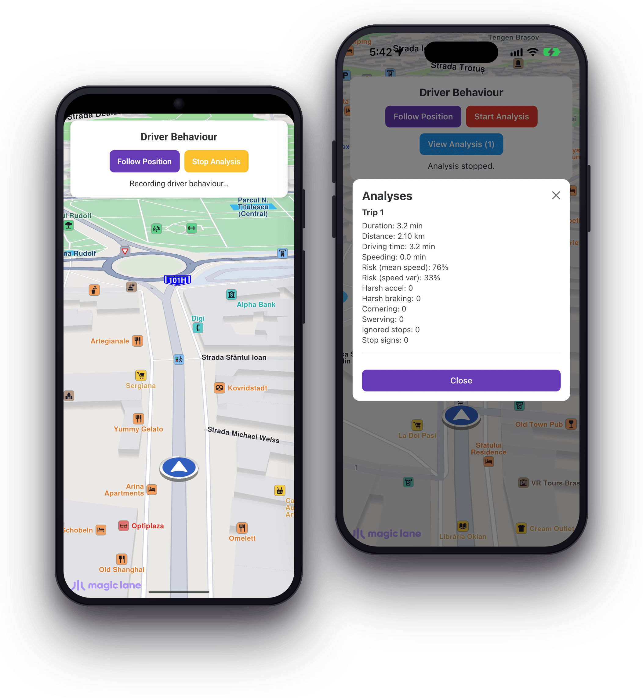

# Driver Behaviour (React Native)

This app follows the live GPS position, records a driving-behaviour analysis,
and shows the recorded trip stats in a modal.



## What it demonstrates

- Creating a live data source (`DataSource.createLiveDataSource`) and a
  `DriverBehaviour` analyser (`startAnalysis` / `stopAnalysis`).
- Reading `getAllDriverBehaviourAnalyses()` and each `DriverBehaviourAnalysis`
  (distance, speeding, harsh events, risk scores).

## API token

The map renders without a token (with a watermark). A valid token from
[developer.magiclane.com](https://developer.magiclane.com) removes the watermark
and unlocks full functionality. Set it in `App.tsx`:

```ts
const GEMKIT_TOKEN = '<your token>';
```

## Run

Install dependencies first:

```sh
npm install
```

### Android

```sh
npm run android
```

The app is built for the `arm64-v8a` architecture.

To run it on an emulator on a computer with an Intel or AMD processor, which
uses x86_64 system images, add `"x86_64"` to `abiFilters` in
`android/app/build.gradle`:

```groovy
abiFilters "arm64-v8a", "x86_64"
```

### iOS

```sh
cd ios && bundle install && LANG=en_US.UTF-8 LC_ALL=en_US.UTF-8 bundle exec pod install && cd ..
npm run ios
```

## Notes

The SDK calls are identical to the web example; the only platform difference is
that the map is hosted by the `<GLView>` component (full-window) instead of a DOM
element, with the controls floating on top inside a `SafeAreaView` overlay.
