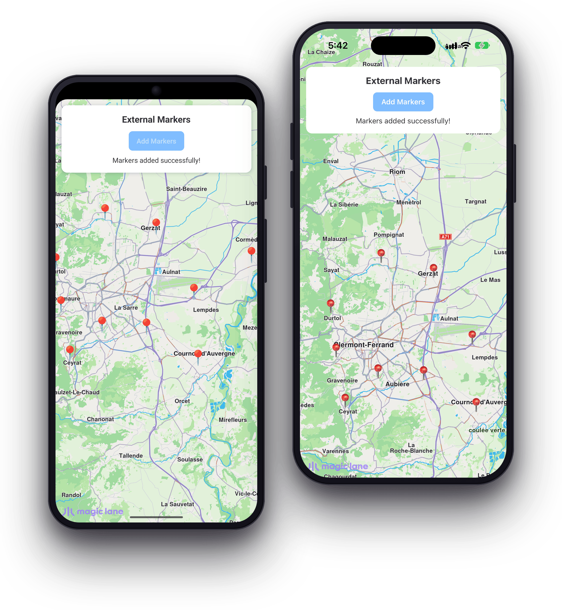

# External Markers (React Native)

Charging stations are fetched from the OpenChargeMap API, converted to GeoJSON,
added to the map as an externally-rendered marker collection, and drawn as
app-owned pins that track the map as it pans and zooms.



## What it demonstrates

- Fetching live data and adding it as a marker collection with
  `map.addGeoJsonAsMarkerCollection(geoJsonString, name)`.
- Registering an `ExternalRendererMarkers` so the app owns the pin visuals:
  `map.preferences.markers.add(collection, { settings, externalRender })`.
- Receiving `externalRender.onNotifyCustom` updates and reading
  `externalRender.visiblePoints` (normalized screen coordinates) to position pins.

The SDK calls are identical to the web example. The web demo positions DOM pins
over the map container; this app positions React Native pin views over the
full-window `<GLView>` using the same normalized coordinates the renderer reports
(the RN equivalent of the web `PinManager`).

## API token

The map renders without a token (with a watermark). A token from
[developer.magiclane.com](https://developer.magiclane.com) removes it. Set it in
`App.tsx`:

```ts
const GEMKIT_TOKEN = '<your token>';
```

## OpenChargeMap API key

The charging stations come from the Open Charge Map API, which requires an API
key. Get one from Open Charge Map (see
[openchargemap.org/site/develop](https://openchargemap.org/site/develop)) and set
it in `App.tsx`:

```ts
const OPENCHARGEMAP_API_KEY = '<your key>';
```

Without a key the map still works, and the app asks for the key instead of
loading stations.

## Run

Install dependencies first:

```sh
npm install
```

### Android

```sh
npm run android
```

The app is built for the `arm64-v8a` architecture.

To run it on an emulator on a computer with an Intel or AMD processor, which
uses x86_64 system images, add `"x86_64"` to `abiFilters` in
`android/app/build.gradle`:

```groovy
abiFilters "arm64-v8a", "x86_64"
```

### iOS

```sh
cd ios && bundle install && LANG=en_US.UTF-8 LC_ALL=en_US.UTF-8 bundle exec pod install && cd ..
npm run ios
```

## Notes

- The OpenChargeMap request needs network access. Change the query coordinates in
  `App.tsx` to fetch another area.
