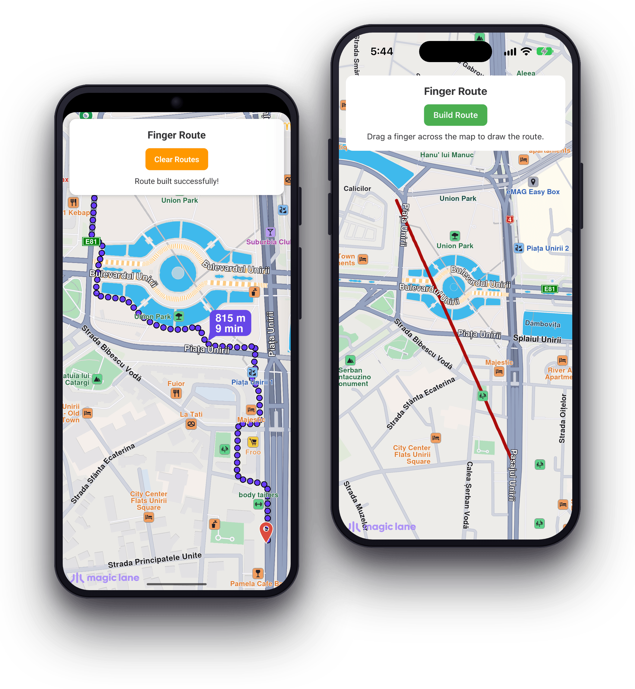

# Finger Route (React Native)

Tap "Draw Route", then drag a finger across the map to draw; "Build Route"
computes a pedestrian route through what was drawn and shows it on the map.



## What it demonstrates

- Drawing waypoints with `map.enableDrawMarkersMode()` and collecting them with
  `map.disableDrawMarkersMode()`.
- Routing through the collected waypoints with `RoutingService.calculateRoute`,
  using pedestrian `RoutePreferences` (`accurateTrackMatch`,
  `ignoreRestrictionsOverTrack`).
- Displaying the routes (`map.preferences.routes.add`), labelling them from
  `route.getTimeDistance()`, and framing them with `map.centerOnRoutes`.
- Cancelling an in-flight calculation (`RoutingService.cancelRoute`) and clearing
  the result.

The SDK calls are identical to the web example; the only platform difference is
that the map is hosted by the `<GLView>` component instead of a DOM element, and
the four-state control (Draw → Build → Cancel → Clear) is a React Native overlay.

## API token

The map renders without a token (with a watermark). A token from
[developer.magiclane.com](https://developer.magiclane.com) removes it. Set it in
`App.tsx`:

```ts
const GEMKIT_TOKEN = '<your token>';
```

## Run

Install dependencies first:

```sh
npm install
```

### Android

```sh
npm run android
```

The app is built for the `arm64-v8a` architecture.

To run it on an emulator on a computer with an Intel or AMD processor, which
uses x86_64 system images, add `"x86_64"` to `abiFilters` in
`android/app/build.gradle`:

```groovy
abiFilters "arm64-v8a", "x86_64"
```

### iOS

```sh
cd ios && bundle install && LANG=en_US.UTF-8 LC_ALL=en_US.UTF-8 bundle exec pod install && cd ..
npm run ios
```
