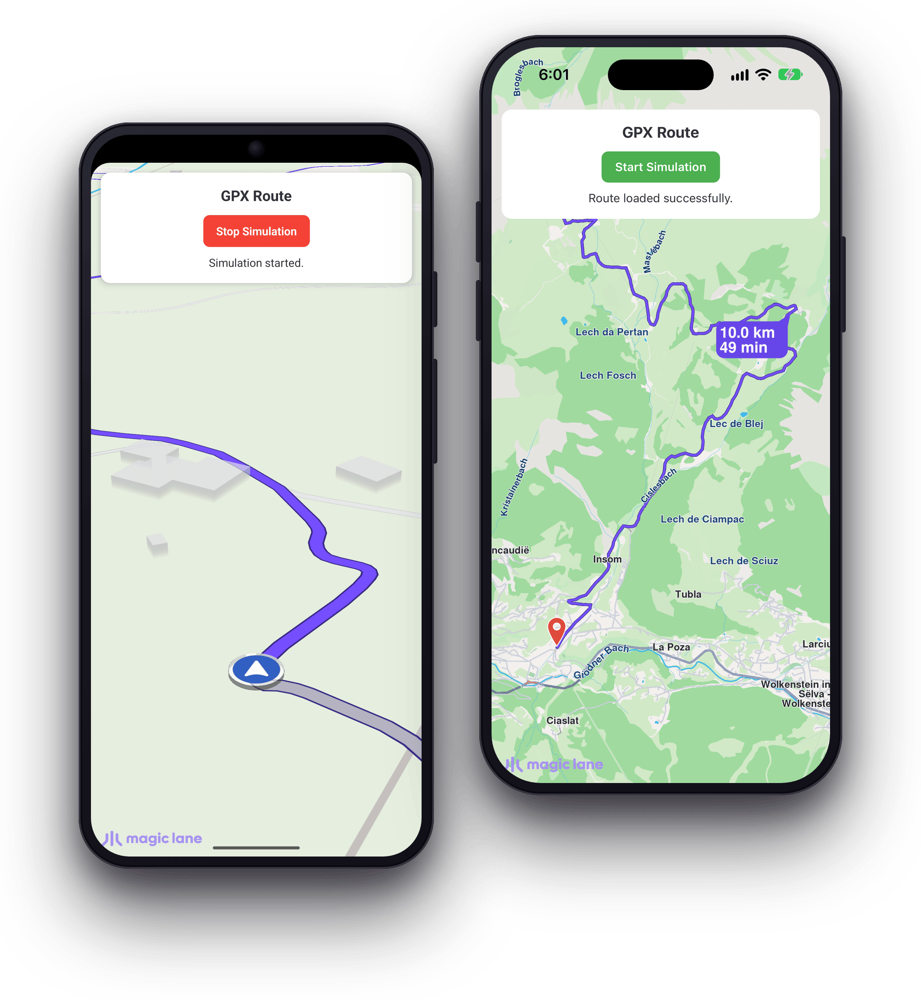

# GPX Route (React Native)

This app parses a GPX track with the SDK, calculates a bicycle route through the
track points, displays it on the map, and simulates navigation along it.



## What it demonstrates

- Parsing a GPX track into landmarks with
  `Path.create({ data, format: PathFileFormat.gpx })` and `path.toLandmarkList()`.
- Calculating a bicycle route with
  `new RoutePreferences({ transportMode: RouteTransportMode.bicycle })` and
  `RoutingService.calculateRoute`.
- Displaying the route and simulating it with
  `NavigationService.startSimulation(route, undefined, { speedMultiplier: 2 })`.

The SDK calls are identical to the web example; the only platform difference is
that the map is hosted by the `<GLView>` component instead of a DOM element.

## GPX source

The web demo loads a large `recorded_route.gpx` from its `public/` folder via
`fetch`. A plain React Native project cannot read a bundled asset's raw bytes
without a native filesystem module, so this app **embeds a compact GPX track
inline** (a subset of a real Seceda hike in the Dolomites) and feeds its bytes to
the identical `Path.create(...)` call. To use a real file, add a filesystem
package (e.g. `react-native-fs`), read the `.gpx` bytes, and pass them to
`Path.create`.

## API token

The map renders without a token (with a watermark). A token from
[developer.magiclane.com](https://developer.magiclane.com) removes the watermark
and unlocks full functionality. Set it in `App.tsx`:

```ts
const GEMKIT_TOKEN = '<your token>';
```

## Run

Install dependencies first:

```sh
npm install
```

### Android

```sh
npm run android
```

The app is built for the `arm64-v8a` architecture.

To run it on an emulator on a computer with an Intel or AMD processor, which
uses x86_64 system images, add `"x86_64"` to `abiFilters` in
`android/app/build.gradle`:

```groovy
abiFilters "arm64-v8a", "x86_64"
```

### iOS

```sh
cd ios && bundle install && LANG=en_US.UTF-8 LC_ALL=en_US.UTF-8 bundle exec pod install && cd ..
npm run ios
```

## Notes

- `GLView` fills the whole window; the controls float on top inside a
  `SafeAreaView` with `pointerEvents="box-none"`.
