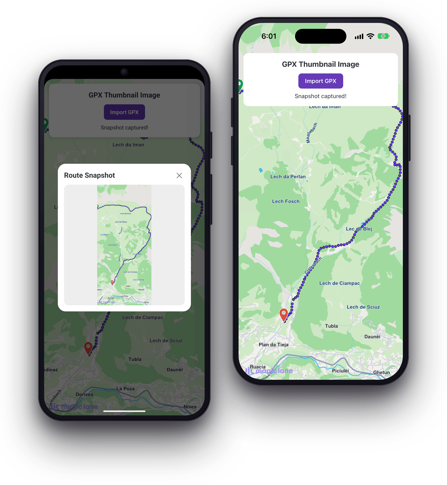

# GPX Thumbnail Image (React Native)

A GPX track is imported, a pedestrian route is computed through it, the camera
frames the route, and the map is captured to a PNG thumbnail shown in a modal.



## What it demonstrates

- Parsing a GPX track into a `Path` with
  `Path.create({ data, format: PathFileFormat.gpx })` and turning it into
  waypoints with `path.toLandmarkList()`.
- Routing through the track (`RoutingService.calculateRoute`) and rendering it
  with `RouteRenderSettings` (`RouteRenderOptions.main`, `showWaypoints`).
- Framing the route (`map.centerOnArea(route.geographicArea, ...)`) and capturing
  the map to a PNG with `map.captureImage()`.

The SDK calls are identical to the web example; the only platform difference is
that the map is hosted by the `<GLView>` component, the captured bytes are shown
in a React Native `<Image>` (base64 data URI) inside a `<Modal>`.

## Asset note

The web demo fetches a 388 KB `recorded_route.gpx` from the Vite `public` folder,
which has no React Native equivalent (no dev web server). A short inline GPX track
(sampled from that same Seceda, Italy recording) is embedded in `App.tsx` and
encoded to bytes at runtime, so the example is self-contained. To import a full
recording, load bundled GPX asset bytes via a native module / `react-native-fs`
and pass them to `Path.create`.

## API token

The map renders without a token (with a watermark). A token from
[developer.magiclane.com](https://developer.magiclane.com) removes it. Set it in
`App.tsx`:

```ts
const GEMKIT_TOKEN = '<your token>';
```

## Run

Install dependencies first:

```sh
npm install
```

### Android

```sh
npm run android
```

The app is built for the `arm64-v8a` architecture.

To run it on an emulator on a computer with an Intel or AMD processor, which
uses x86_64 system images, add `"x86_64"` to `abiFilters` in
`android/app/build.gradle`:

```groovy
abiFilters "arm64-v8a", "x86_64"
```

### iOS

```sh
cd ios && bundle install && LANG=en_US.UTF-8 LC_ALL=en_US.UTF-8 bundle exec pod install && cd ..
npm run ios
```
