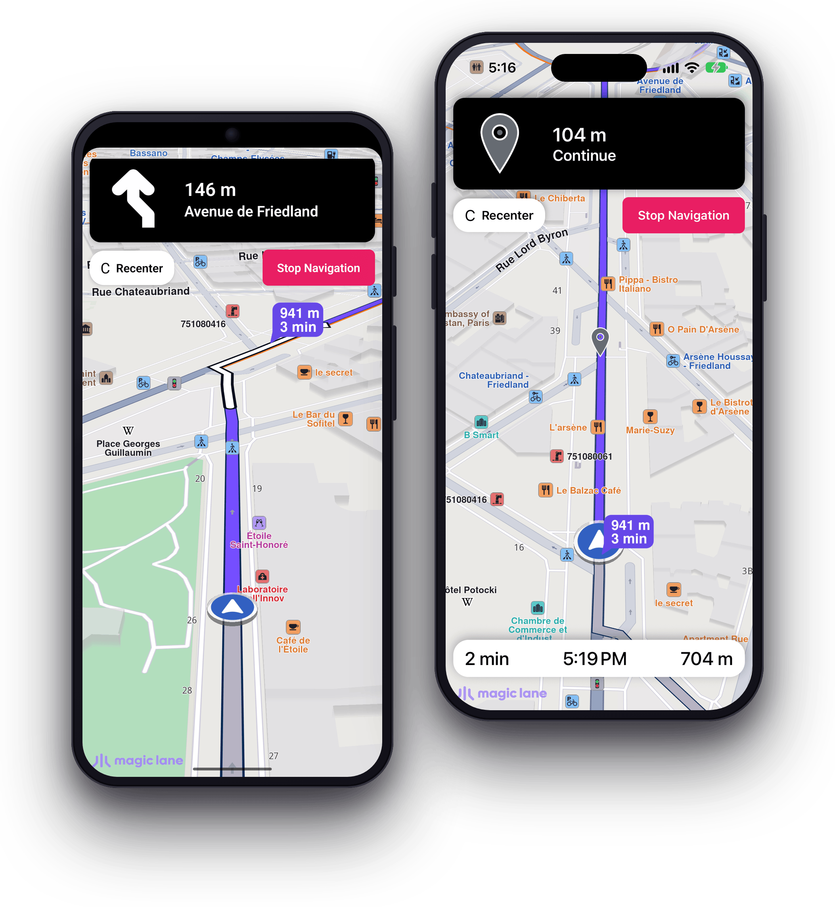

# Human Voice Navigation (React Native)

This app calculates a short route in Paris, simulates navigation along it and
speaks the turn-by-turn instructions with a recorded human voice.



## What it demonstrates

- Initializing the SDK with `MagicLaneReactNativeSDK.init({authorization})`.
- Selecting a voice: the first human voice already on the device
  (`ContentStore.getLocalContentList(ContentType.humanVoice)`) is applied with
  `SdkSettings.setVoiceByPath(...)`. If no human voice has been downloaded, the
  SDK keeps its default voice. See [`voice_download`](../voice_download) for
  downloading one.
- Calculating a route with an intermediate waypoint
  (`RoutingService.calculateRoute`), showing the alternatives with a
  distance/duration label and fitting them on screen with `centerOnRoutes`.
- Simulating navigation with `NavigationService.startSimulation`, turning sound
  on with `SoundPlayingService.canPlaySounds = true`, and showing the next-turn
  image, street name, remaining time, ETA and remaining distance.
- Stopping the simulation with `NavigationService.cancelNavigation`.

## API token

Online routing and downloading voices require a valid token from
[developer.magiclane.com](https://developer.magiclane.com) and an internet
connection. Set it in `App.tsx`:

```ts
const GEMKIT_TOKEN = '<your token>';
```

## Run

Install dependencies first:

```sh
npm install
```

### Android

```sh
npm run android
```

The app is built for the `arm64-v8a` architecture.

To run it on an emulator on a computer with an Intel or AMD processor, which
uses x86_64 system images, add `"x86_64"` to `abiFilters` in
`android/app/build.gradle`:

```groovy
abiFilters "arm64-v8a", "x86_64"
```

### iOS

```sh
cd ios && bundle install && LANG=en_US.UTF-8 LC_ALL=en_US.UTF-8 bundle exec pod install && cd ..
npm run ios
```
