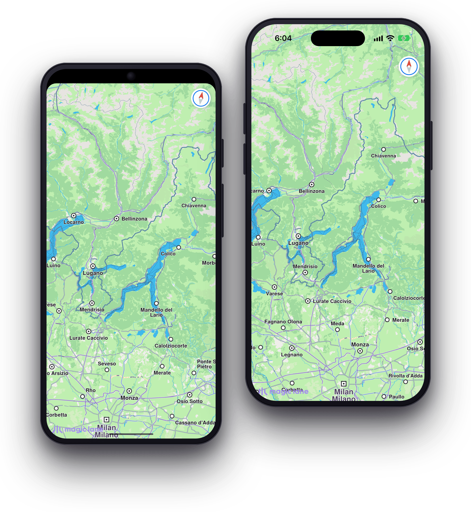

# Map Compass (React Native)

This app shows a compass that rotates with the map and snaps the map back to
north-up on tap.



## What it demonstrates

- Fetching an engine image with `SdkSettings.getImageById` (using
  `EngineMisc.compassEnableSensorON`) and rendering it as an `<Image>`.
- Tracking the map's heading via `map.registerMapAngleUpdateCallback` and
  rotating the compass accordingly.
- Resetting the map orientation with `map.alignNorthUp`.

The SDK usage is the same as on the web; the only platform difference is that the
map is hosted by `<GLView>`. Because React Native (Hermes) has no global `btoa`,
the raw PNG bytes returned by the SDK are base64-encoded in `App.tsx` before being
shown as a data URI.

## API token

The map renders without a token (with a watermark). A token from
[developer.magiclane.com](https://developer.magiclane.com) removes it. Set it in
`App.tsx`:

```ts
const GEMKIT_TOKEN = '<your token>';
```

## Run

Install dependencies first:

```sh
npm install
```

### Android

```sh
npm run android
```

The app is built for the `arm64-v8a` architecture.

To run it on an emulator on a computer with an Intel or AMD processor, which
uses x86_64 system images, add `"x86_64"` to `abiFilters` in
`android/app/build.gradle`:

```groovy
abiFilters "arm64-v8a", "x86_64"
```

### iOS

```sh
cd ios && bundle install && LANG=en_US.UTF-8 LC_ALL=en_US.UTF-8 bundle exec pod install && cd ..
npm run ios
```
