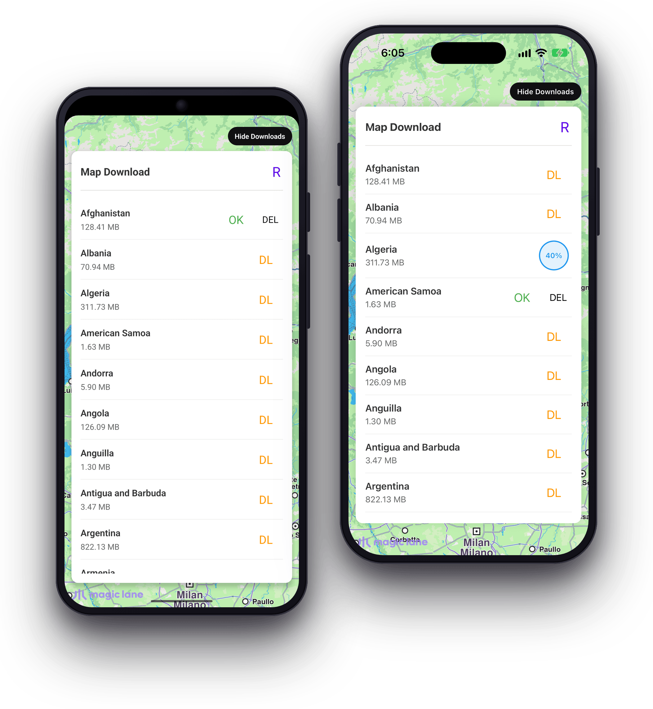

# Map Download (React Native)

This app lists the road maps available in the content store and downloads them
for offline use. To refresh maps that are already on the device, see
[`map_update`](../map_update).



## What it demonstrates

- Initializing the SDK with `MagicLaneReactNativeSDK.init({authorization})` and
  allowing content downloads on charged networks
  (`SdkSettings.setAllowOffboardServiceOnExtraChargedNetwork`).
- Listing road maps with
  `ContentStore.asyncGetStoreContentList(ContentType.roadMap, ...)`.
- Downloading a map with `ContentStoreItem.asyncDownload(...)`, reporting
  progress, pausing it with `pauseDownload` and deleting a downloaded map with
  `deleteContent`.
- Reloading the list when the connection comes back, through
  `SdkSettings.offBoardListener.registerOnConnectionStatusUpdated`.

Tap **Show Downloads** to open the list. Tap a map to start or pause its
download; downloaded maps show **OK** and a **DEL** button.

## API token

Listing and downloading maps require a valid token from
[developer.magiclane.com](https://developer.magiclane.com) and an internet
connection. Set it in `App.tsx`:

```ts
const GEMKIT_TOKEN = '<your token>';
```

## Run

Install dependencies first:

```sh
npm install
```

### Android

```sh
npm run android
```

The app is built for the `arm64-v8a` architecture.

To run it on an emulator on a computer with an Intel or AMD processor, which
uses x86_64 system images, add `"x86_64"` to `abiFilters` in
`android/app/build.gradle`:

```groovy
abiFilters "arm64-v8a", "x86_64"
```

### iOS

```sh
cd ios && bundle install && LANG=en_US.UTF-8 LC_ALL=en_US.UTF-8 bundle exec pod install && cd ..
npm run ios
```
