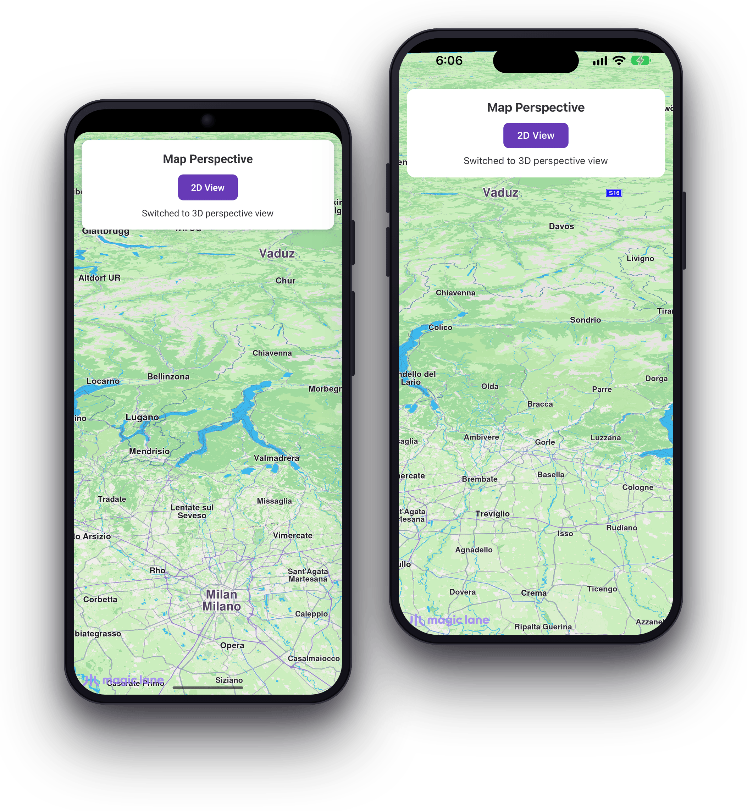

# Map Perspective (React Native)

A button toggles the map between a flat 2D view and a tilted 3D perspective.



## What it demonstrates

- Switching 3D building rendering with
  `map.preferences.buildingsVisibility` (`BuildingsVisibility.threeDimensional` /
  `twoDimensional`).
- Tilting the camera with `map.preferences.tiltAngle` (30° for 3D, 90° for 2D).

The SDK usage is the same as on the web; the only platform difference is that the
map is hosted by `<GLView>` and the toggle is a `<TouchableOpacity>`.

## API token

The map renders without a token (with a watermark). A token from
[developer.magiclane.com](https://developer.magiclane.com) removes it. Set it in
`App.tsx`:

```ts
const GEMKIT_TOKEN = '<your token>';
```

## Run

Install dependencies first:

```sh
npm install
```

### Android

```sh
npm run android
```

The app is built for the `arm64-v8a` architecture.

To run it on an emulator on a computer with an Intel or AMD processor, which
uses x86_64 system images, add `"x86_64"` to `abiFilters` in
`android/app/build.gradle`:

```groovy
abiFilters "arm64-v8a", "x86_64"
```

### iOS

```sh
cd ios && bundle install && LANG=en_US.UTF-8 LC_ALL=en_US.UTF-8 bundle exec pod install && cd ..
npm run ios
```
