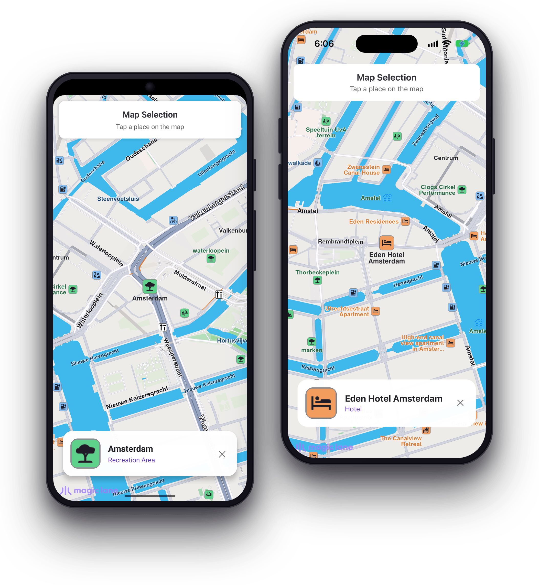

# Map Selection (React Native)

Tapping the map selects the landmark under the cursor, highlights it, and shows
its name, category, and icon.



## What it demonstrates

- Converting a tap into a cursor selection with `map.setCursorScreenPosition` and
  `map.cursorSelectionLandmarks`.
- Highlighting the selection with `map.activateHighlight` and clearing it with
  `map.deactivateAllHighlights` / `map.resetMapSelection`.
- Reading `landmark.name`, `landmark.categories`, `landmark.getImage`, and centering
  on `landmark.coordinates`.

The SDK usage is the same as on the web; the only platform difference is that the
map is hosted by `<GLView>` and the info card is built from React Native views. The
landmark icon bytes are base64-encoded in `App.tsx` for use as an `<Image>` URI.

## API token

The map renders without a token (with a watermark). A token from
[developer.magiclane.com](https://developer.magiclane.com) removes it. Set it in
`App.tsx`:

```ts
const GEMKIT_TOKEN = '<your token>';
```

## Run

Install dependencies first:

```sh
npm install
```

### Android

```sh
npm run android
```

The app is built for the `arm64-v8a` architecture.

To run it on an emulator on a computer with an Intel or AMD processor, which
uses x86_64 system images, add `"x86_64"` to `abiFilters` in
`android/app/build.gradle`:

```groovy
abiFilters "arm64-v8a", "x86_64"
```

### iOS

```sh
cd ios && bundle install && LANG=en_US.UTF-8 LC_ALL=en_US.UTF-8 bundle exec pod install && cd ..
npm run ios
```
