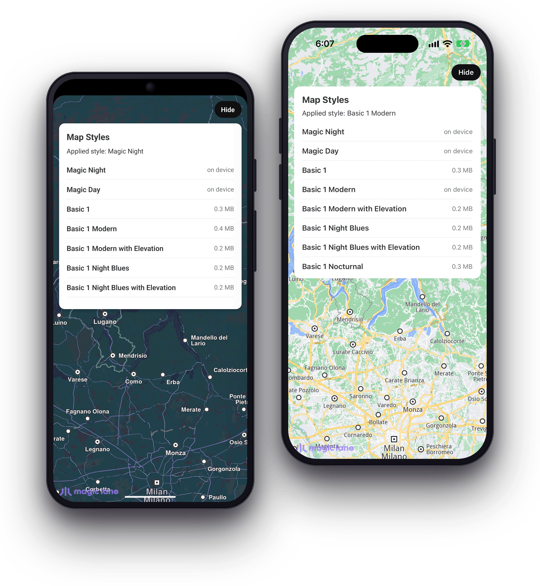

# Map Styles Update (React Native)

This app lists the available map view styles, applies a chosen style to the live
map, and can update downloaded styles to newer versions.



## What it demonstrates

- Configuring auto-update per content type with `AutoUpdateSettings` (road maps
  auto-update; view styles are managed manually here), set via
  `SdkSettings.offBoardListener.autoUpdateSettings`.
- Listing view styles from the content store
  (`ContentStore.asyncGetStoreContentList(ContentType.viewStyleHighRes)`).
- Downloading a style on demand and applying it to the map with
  `map.preferences.setMapStyle(item, /* smoothTransition */ true)`.
- Checking for and applying newer style versions with a `ContentUpdater`
  (the same `update` / `apply` flow as [`map_update`](../map_update)), driven by
  `registerOnAvailableContentUpdate`.

## API token

Listing and downloading styles require a valid token from
[developer.magiclane.com](https://developer.magiclane.com) and an internet
connection. Set it in `App.tsx`:

```ts
const GEMKIT_TOKEN = '<your token>';
```

## Run

```sh
npm install
# Android
npm run android
# iOS
cd ios && bundle install && LANG=en_US.UTF-8 LC_ALL=en_US.UTF-8 bundle exec pod install && cd ..
npm run ios
```

The app is built for the `arm64-v8a` architecture.

To run it on an emulator on a computer with an Intel or AMD processor, which
uses x86_64 system images, add `"x86_64"` to `abiFilters` in
`android/app/build.gradle`:

```groovy
abiFilters "arm64-v8a", "x86_64"
```

## Notes

- Tap **Styles** (top-right) to open the panel, then tap any style to download
  (if needed) and apply it. Styles already on the device are marked "on device"
  and apply instantly.
- The "Update styles" button appears only when the SDK reports that newer style
  data is available for styles already downloaded.
