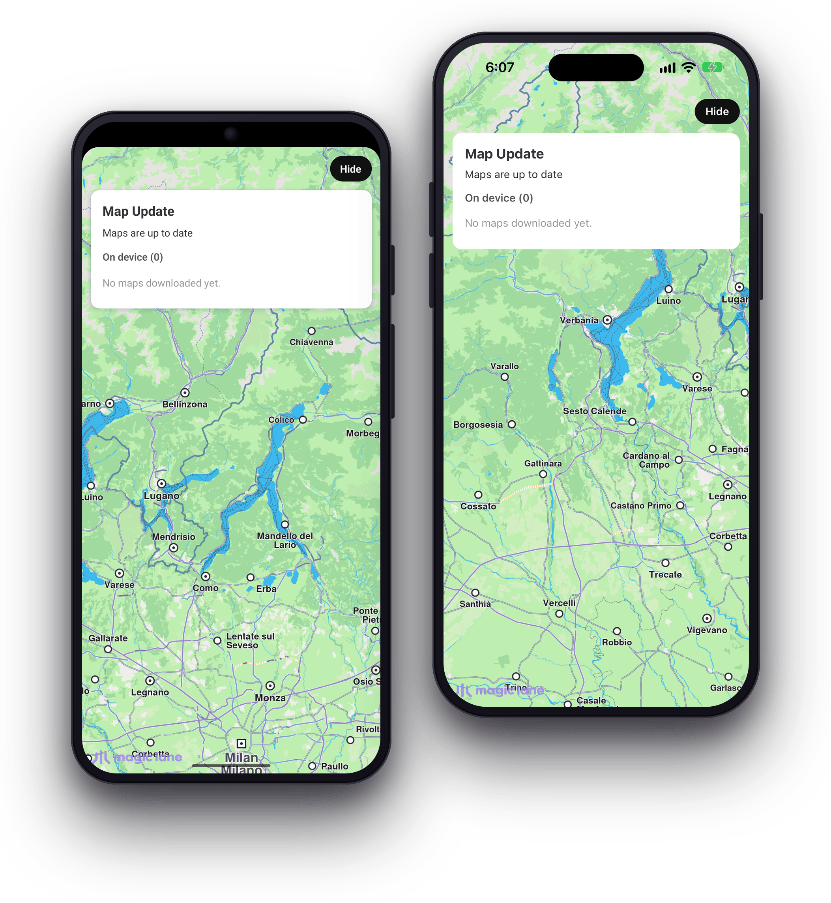

# Map Update (React Native)

This app demonstrates the road-map **update** flow - refreshing the maps already
on the device to a newer version - which is distinct from a first-time download
(see [`map_download`](../map_download)).



## What it demonstrates

- Asking the content store whether newer map data exists with
  `ContentStore.checkForUpdate(ContentType.roadMap)`. The verdict arrives
  asynchronously through
  `SdkSettings.offBoardListener.registerOnWorldwideRoadMapSupportStatus`, as a
  `MapStatus` (`UpToDate` / `OldData` / `ExpiredData`).
- Running the update with a `ContentUpdater`
  (`ContentStore.createContentUpdater` → `updater.update(...)`), reporting
  progress, and finalizing it with `updater.apply()` once the new maps are
  downloaded (this swaps the old maps for the new ones and bumps the version).
- Cancelling an in-progress update with `updater.cancel()`.

## API token

Querying the store and downloading updated map data require a valid token from
[developer.magiclane.com](https://developer.magiclane.com) and an internet
connection. Set it in `App.tsx`:

```ts
const GEMKIT_TOKEN = '<your token>';
```

## Run

```sh
npm install
# Android
npm run android
# iOS
cd ios && bundle install && LANG=en_US.UTF-8 LC_ALL=en_US.UTF-8 bundle exec pod install && cd ..
npm run ios
```

The app is built for the `arm64-v8a` architecture.

To run it on an emulator on a computer with an Intel or AMD processor, which
uses x86_64 system images, add `"x86_64"` to `abiFilters` in
`android/app/build.gradle`:

```groovy
abiFilters "arm64-v8a", "x86_64"
```

## Note on observing an update

To *observe* an update you need maps on the device that are actually out of
date. The app shows whatever status the SDK reports for the maps currently on
the device. If your maps are already current, the status reads "up to date" and
no update button appears; that is the expected behavior.
