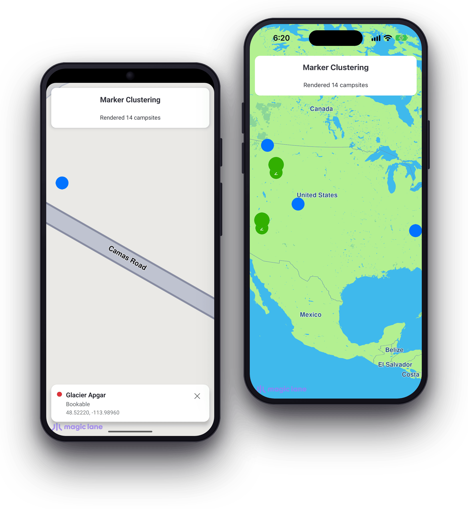

# Marker Clustering (React Native)

Campsites are rendered with native clustering: a count-bearing cluster layer
plus a detail layer with one named pin per campsite. Tap a cluster to expand it;
tap a pin for an info panel.



## What it demonstrates

- Native clustering with two overlapping `MarkerCollection`s grouped at the same
  zoom (`MarkerCollectionRenderSettings.pointsGroupingZoomLevel` +
  `buildPointsGroupConfig`), one built with `collection.add(Marker.fromCoords)`
  and one via the optimised `markers.addList({ list, settings, ... })` bulk path.
- Per-marker metadata carried in the JSON marker name (recovered on tap), with the
  white cluster count enabled via `labelGroupTextColor`.
- Tap handling with `map.registerTouchCallback`: a tapped cluster is expanded
  with `map.expandCluster(pos, { onMembers })`, which zooms in until the members
  separate. When they sit too close for that, `onMembers` receives them and the
  app shows the first one in the info panel with the member count (React Native
  has no on-screen fan-out). Otherwise the tapped pin is read from
  `map.cursorSelectionMarkers()`.

The map is hosted by the `<GLView>` component, and the tapped-pin info panel is
a React Native overlay.

## Sample data

The campsites are a small inline dataset in `App.tsx`, drawn with the SDK's
default cluster bubbles and markers.

## API token

The map renders without a token (with a watermark). A token from
[developer.magiclane.com](https://developer.magiclane.com) removes it. Set it in
`App.tsx`:

```ts
const GEMKIT_TOKEN = '<your token>';
```

## Run

Install dependencies first:

```sh
npm install
```

### Android

```sh
npm run android
```

The app is built for the `arm64-v8a` architecture.

To run it on an emulator on a computer with an Intel or AMD processor, which
uses x86_64 system images, add `"x86_64"` to `abiFilters` in
`android/app/build.gradle`:

```groovy
abiFilters "arm64-v8a", "x86_64"
```

### iOS

```sh
cd ios && bundle install && LANG=en_US.UTF-8 LC_ALL=en_US.UTF-8 bundle exec pod install && cd ..
npm run ios
```
