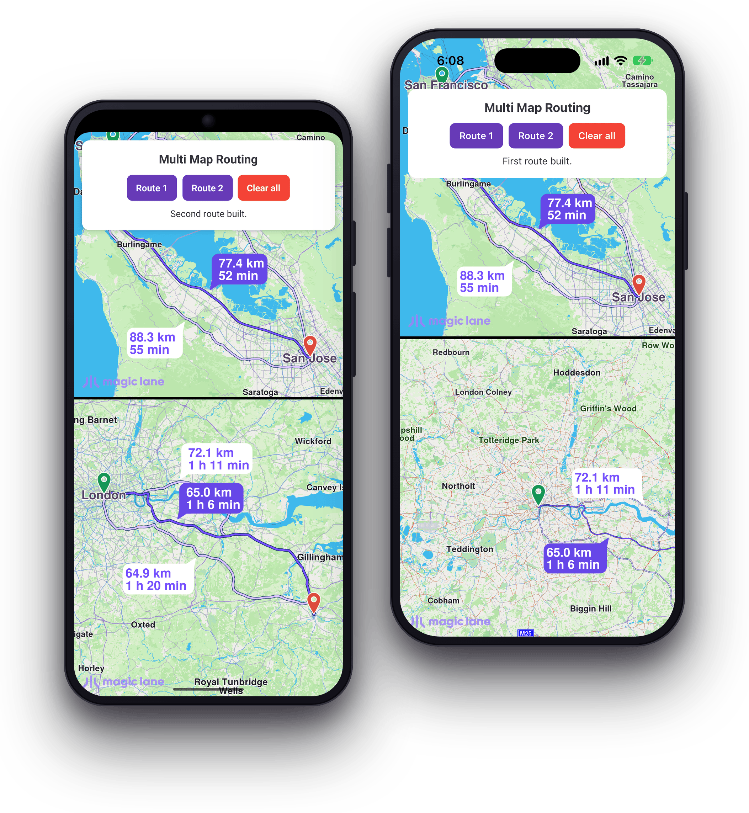

# Multi Map Routing (React Native)

This app renders **two independent maps** stacked vertically (top: San Francisco
Bay area, bottom: London area). "Route 1" builds routes on the top map, "Route 2"
on the bottom map, and "Clear all" removes them from both.



## What it demonstrates

- Hosting two map views at once with two `<GLView>` components, each exposing its
  own `gemMap` through `onMapReady`.
- Calculating a route per map with `RoutingService.calculateRoute` and drawing it
  on that map's `map.preferences.routes`, framed with
  `map.centerOnRoutes({ routes })`.
- Cancelling in-flight calculations and clearing both maps' routes.

The SDK calls are identical to the web example; the only platform difference is
that each map is hosted by a `<GLView>` component instead of a DOM container.

## API token

The map renders without a token (with a watermark). A token from
[developer.magiclane.com](https://developer.magiclane.com) removes the watermark
and unlocks full functionality. Set it in `App.tsx`:

```ts
const GEMKIT_TOKEN = '<your token>';
```

## Run

Install dependencies first:

```sh
npm install
```

### Android

```sh
npm run android
```

The app is built for the `arm64-v8a` architecture.

To run it on an emulator on a computer with an Intel or AMD processor, which
uses x86_64 system images, add `"x86_64"` to `abiFilters` in
`android/app/build.gradle`:

```groovy
abiFilters "arm64-v8a", "x86_64"
```

### iOS

```sh
cd ios && bundle install && LANG=en_US.UTF-8 LC_ALL=en_US.UTF-8 bundle exec pod install && cd ..
npm run ios
```

## Notes

- The two maps split the window into equal halves, and the controls float on top
  inside a `SafeAreaView`, so each map has its final size from the first render.
  On Android, a map whose size changes after it is created stops drawing (Magic
  Lane engine 0.2.0); this includes a device rotation.
