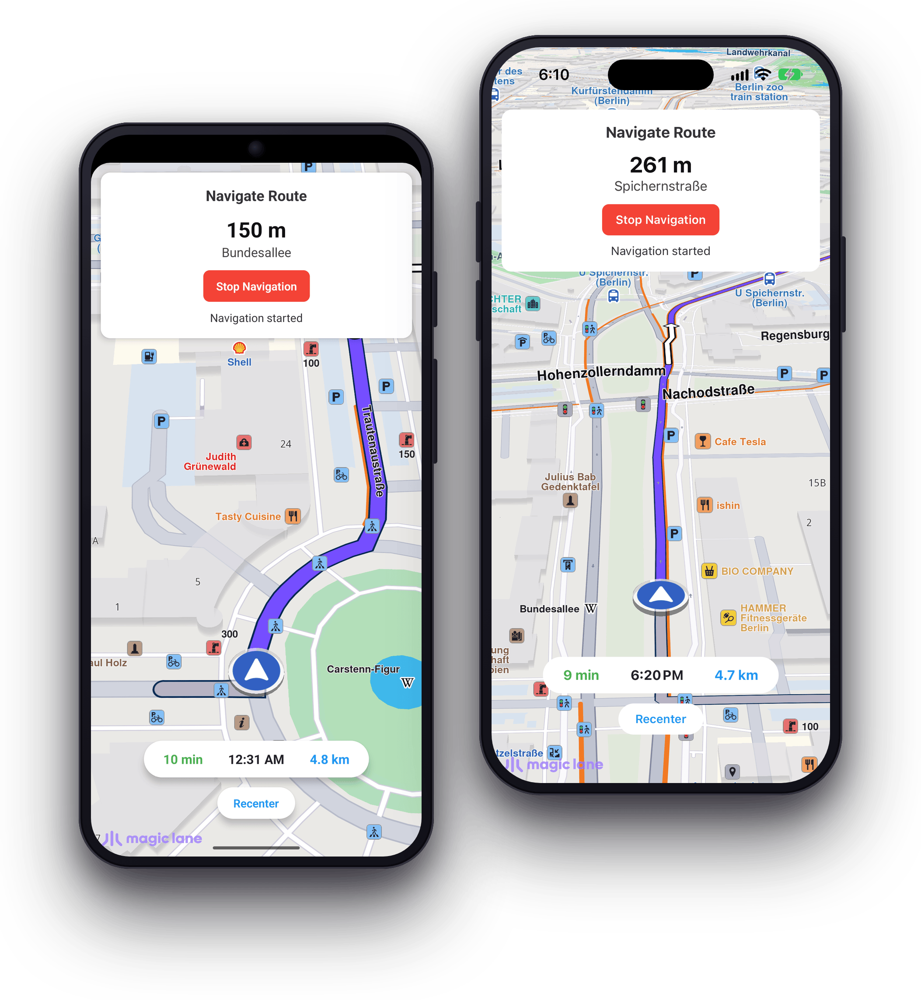

# Navigate Route (React Native)

This app builds a route, starts turn-by-turn navigation, shows the live
instruction (next turn distance + street name) and a bottom panel with remaining
time, ETA and distance, plus a Recenter button.



## What it demonstrates

- Calculating a route with `RoutingService.calculateRoute`.
- Starting guidance with `NavigationService.startSimulation(route, undefined,
  { onNavigationInstruction, onError })` and stopping it with
  `NavigationService.cancelNavigation(handler)`.
- Reading live guidance data from `NavigationInstruction`
  (`timeDistanceToNextTurn`, `remainingTravelTimeDistance`, `nextStreetName`).
- Keeping the camera on the vehicle with `map.startFollowingPosition()`.

The SDK calls are identical to the web example; the only platform difference is
that the map is hosted by the `<GLView>` component instead of a DOM element.

## Departure point

The web demo departs from the device's **live GPS location**. To keep this app
deterministic in a simulator, it uses a fixed departure (Berlin). To use the
live location instead, request `PositionService.requestLocationPermission()`,
call `PositionService.instance.setLiveDataSource()`, and build the departure
landmark from `PositionService.instance.position`.

## API token

The map renders without a token (with a watermark). A token from
[developer.magiclane.com](https://developer.magiclane.com) removes the watermark
and unlocks full functionality. Set it in `App.tsx`:

```ts
const GEMKIT_TOKEN = '<your token>';
```

## Run

Install dependencies first:

```sh
npm install
```

### Android

```sh
npm run android
```

The app is built for the `arm64-v8a` architecture.

To run it on an emulator on a computer with an Intel or AMD processor, which
uses x86_64 system images, add `"x86_64"` to `abiFilters` in
`android/app/build.gradle`:

```groovy
abiFilters "arm64-v8a", "x86_64"
```

### iOS

```sh
cd ios && bundle install && LANG=en_US.UTF-8 LC_ALL=en_US.UTF-8 bundle exec pod install && cd ..
npm run ios
```

## Notes

- `GLView` fills the whole window; the navigation panels float on top inside
  `SafeAreaView` overlays with `pointerEvents="box-none"`.
