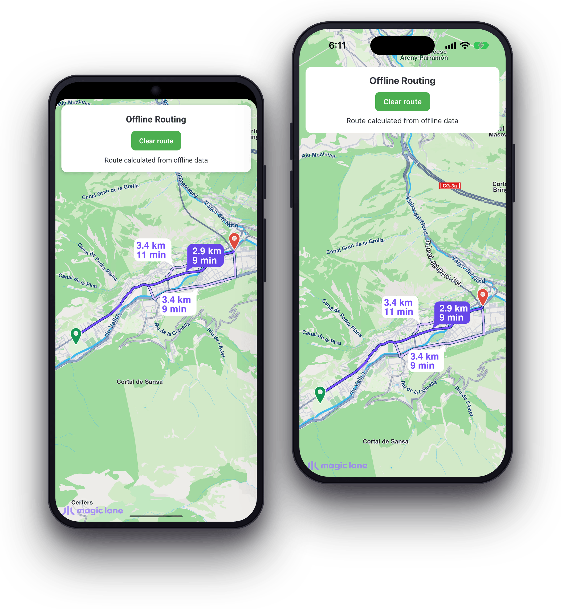

# Offline Routing (React Native)

This app downloads a region's road map, denies the internet connection, and then
calculates a route using only the on-device data.



## What it demonstrates

- Downloading a road map region with `ContentStore` (`asyncGetStoreContentList`
  → `ContentStoreItem.asyncDownload`) and reporting progress.
- Switching to fully offline operation with
  `SdkSettings.setAllowInternetConnection(false)`.
- Calculating and displaying a route offline with
  `RoutingService.calculateRoute`, then centering the camera with
  `map.centerOnRoutes(...)`.

The SDK calls are identical to the web examples; the only platform difference is
that the map is hosted by the `<GLView>` component instead of a DOM element.

## API token

The map renders without a token (with a watermark), but **downloading the
offline region requires a valid token** from
[developer.magiclane.com](https://developer.magiclane.com) and an initial
internet connection. Set it in `App.tsx`:

```ts
const GEMKIT_TOKEN = '<your token>';
```

## Run

Install dependencies first:

```sh
npm install
```

### Android

```sh
npm run android
```

The app is built for the `arm64-v8a` architecture.

To run it on an emulator on a computer with an Intel or AMD processor, which
uses x86_64 system images, add `"x86_64"` to `abiFilters` in
`android/app/build.gradle`:

```groovy
abiFilters "arm64-v8a", "x86_64"
```

### iOS

```sh
cd ios && bundle install && LANG=en_US.UTF-8 LC_ALL=en_US.UTF-8 bundle exec pod install && cd ..
npm run ios
```

## Notes

- The demo uses the **Andorra** region because it is small and downloads
  quickly. Change `OFFLINE_MAP_NAME` and the `DEPARTURE`/`DESTINATION`
  coordinates in `App.tsx` to try another region.
- Once the region is on the device, the app detects it on next launch and goes
  straight to offline mode.
