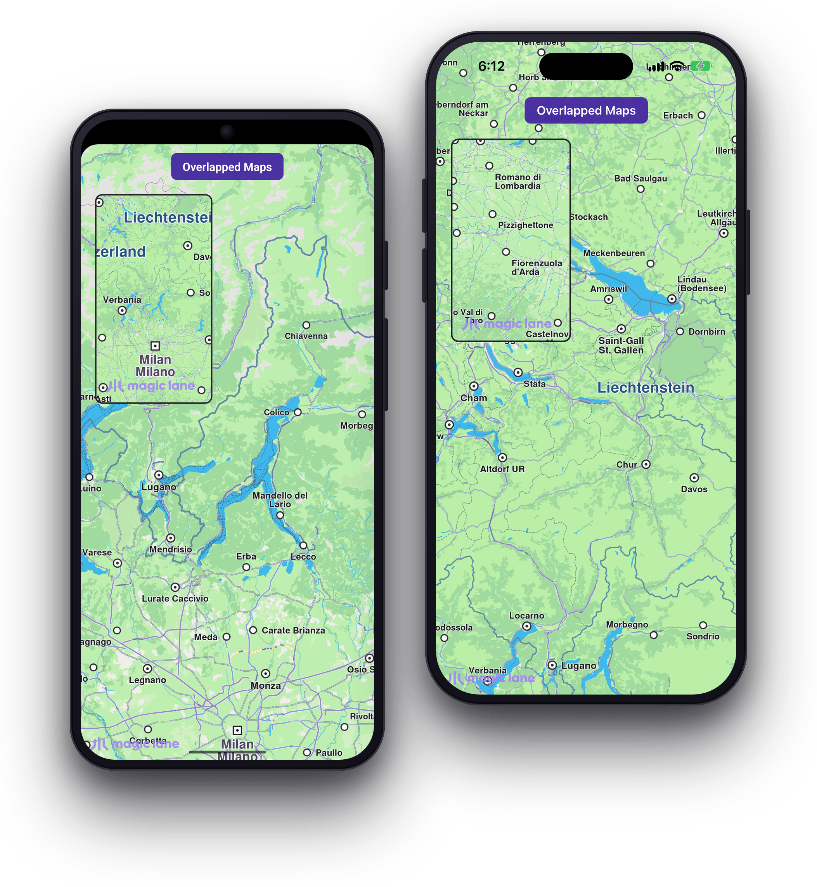

# Overlapped Maps (React Native)

This app shows a full-screen background map with a smaller, independent map
overlapping it near the top-left corner.



## What it demonstrates

- Running two independent maps at once - two `<GLView>` instances stacked, the RN
  equivalent of the web demo's two `gemKit.createView` calls into overlapping
  containers.

The SDK usage is the same as on the web; the only platform difference is that each
map is a `<GLView>` positioned with absolute layout instead of absolutely
positioned DOM containers.

## API token

The maps render without a token (with a watermark). A token from
[developer.magiclane.com](https://developer.magiclane.com) removes it. Set it in
`App.tsx`:

```ts
const GEMKIT_TOKEN = '<your token>';
```

## Notes

- The smaller overlay map is intentionally smaller than the window. On some Android
  devices multiple simultaneous GL surfaces are resource-heavy.

## Run

Install dependencies first:

```sh
npm install
```

### Android

```sh
npm run android
```

The app is built for the `arm64-v8a` architecture.

To run it on an emulator on a computer with an Intel or AMD processor, which
uses x86_64 system images, add `"x86_64"` to `abiFilters` in
`android/app/build.gradle`:

```groovy
abiFilters "arm64-v8a", "x86_64"
```

### iOS

```sh
cd ios && bundle install && LANG=en_US.UTF-8 LC_ALL=en_US.UTF-8 bundle exec pod install && cd ..
npm run ios
```
