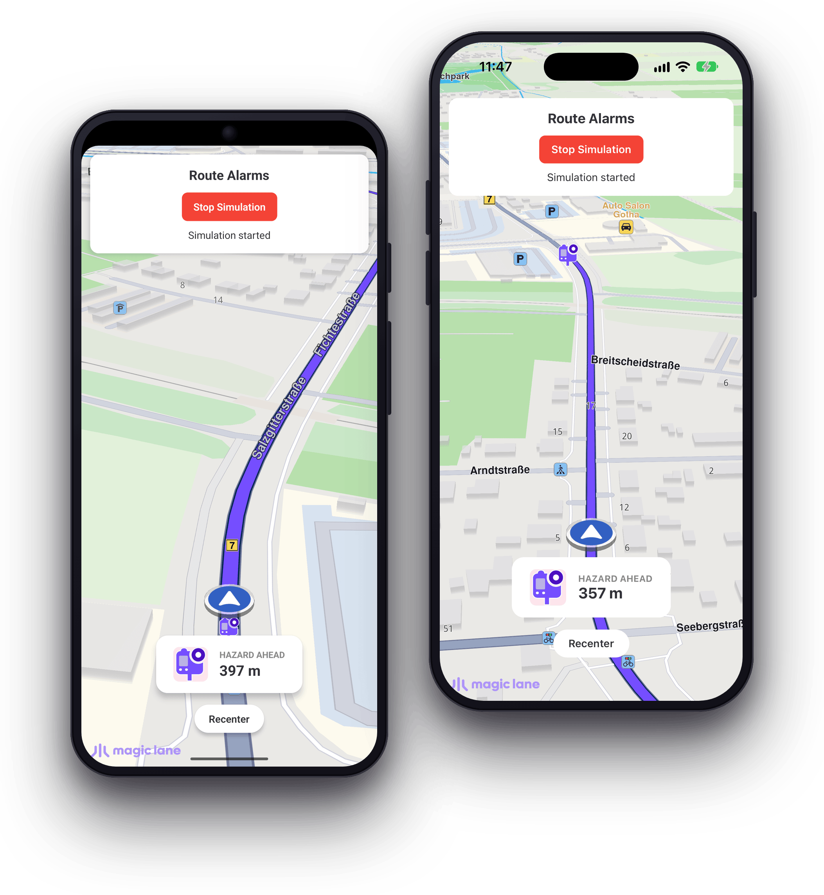

# Route Alarms (React Native)

This app searches for a map report, builds a route passing through it, simulates
navigation, and surfaces the closest overlay-item alarm (hazard / safety camera)
in a bottom panel.



## What it demonstrates

- `SearchService.searchInArea` to find a report inside a rectangular area, with
  the search limited to the social reports overlay through
  `SearchPreferences.overlays.add(CommonOverlayId.SocialReports)`, and
  reshaping a route around it with `Route.getDistanceOnRoute` /
  `getCoordinateOnRoute`.
- Monitoring alarms with `AlarmService` + `AlarmListener` (`onOverlayItemAlarmsUpdated`)
  for the overlays subscribed with `AlarmService.overlays.add(...)`
  (`CommonOverlayId.SocialReports` and `CommonOverlayId.Safety`), then reading
  `AlarmService.overlayItemAlarms.items` and picking the closest by `distance`.
- Rendering the overlay item's icon from its image byte buffer as a base64 `<Image>`.

## API token

The map renders without a token (with a watermark). A valid token from
[developer.magiclane.com](https://developer.magiclane.com) removes the watermark
and unlocks full functionality. Set it in `App.tsx`:

```ts
const GEMKIT_TOKEN = '<your token>';
```

## Run

Install dependencies first:

```sh
npm install
```

### Android

```sh
npm run android
```

The app is built for the `arm64-v8a` architecture.

To run it on an emulator on a computer with an Intel or AMD processor, which
uses x86_64 system images, add `"x86_64"` to `abiFilters` in
`android/app/build.gradle`:

```groovy
abiFilters "arm64-v8a", "x86_64"
```

### iOS

```sh
cd ios && bundle install && LANG=en_US.UTF-8 LC_ALL=en_US.UTF-8 bundle exec pod install && cd ..
npm run ios
```

## Notes

The SDK calls are those of the web example, plus the overlay subscriptions
described above (`SearchPreferences.overlays`, `AlarmService.overlays`). The
only platform difference is that the map is hosted by the `<GLView>` component
(full-window) instead of a DOM element, with the controls floating on top inside
a `SafeAreaView` overlay.
