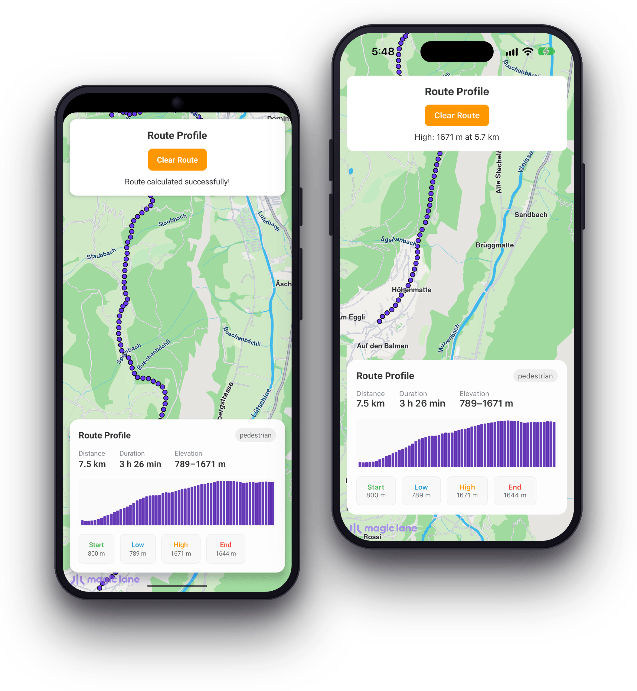

# Route Profile (React Native)

This app calculates a pedestrian route in the Swiss Alps **with a terrain
profile**, draws it, and shows a bottom panel with distance, duration and an
elevation profile. Tapping a key location (Start / Low / High / End) highlights
that point on the map.



## What it demonstrates

- Requesting a terrain profile with
  `new RoutePreferences({ buildTerrainProfile: new BuildTerrainProfile({ enable: true }), transportMode: RouteTransportMode.pedestrian })`.
- Styling routes with
  `new RouteRenderSettings({ options: new Set([RouteRenderOptions.showTraffic, RouteRenderOptions.showHighlights]) })`.
- Reading elevation data with `route.terrainProfile.getElevationSamples(...)`.
- Highlighting a point with `route.getCoordinateOnRoute(distance)`,
  `Landmark.create()` / `setImageFromIcon(GemIcon.searchResultsPin)` and
  `map.activateHighlight([landmark], { renderSettings })` /
  `map.deactivateHighlight()`.

The SDK calls are identical to the web example; the only platform difference is
that the map is hosted by the `<GLView>` component instead of a DOM element, and
the DOM elevation chart becomes a row of scaled `<View>` bars.

## API token

The map renders without a token (with a watermark). A token from
[developer.magiclane.com](https://developer.magiclane.com) removes the watermark
and unlocks full functionality. Set it in `App.tsx`:

```ts
const GEMKIT_TOKEN = '<your token>';
```

## Run

Install dependencies first:

```sh
npm install
```

### Android

```sh
npm run android
```

The app is built for the `arm64-v8a` architecture.

To run it on an emulator on a computer with an Intel or AMD processor, which
uses x86_64 system images, add `"x86_64"` to `abiFilters` in
`android/app/build.gradle`:

```groovy
abiFilters "arm64-v8a", "x86_64"
```

### iOS

```sh
cd ios && bundle install && LANG=en_US.UTF-8 LC_ALL=en_US.UTF-8 bundle exec pod install && cd ..
npm run ios
```

## Notes

- `GLView` fills the whole window; the profile panel floats on top inside a
  `SafeAreaView` with `pointerEvents="box-none"`.
- The web demo's interactive surface / road-type / steepness sliders use mock
  category data; this app keeps the real SDK pieces (elevation samples and
  map highlighting of key points) and omits the mock-only sliders.
