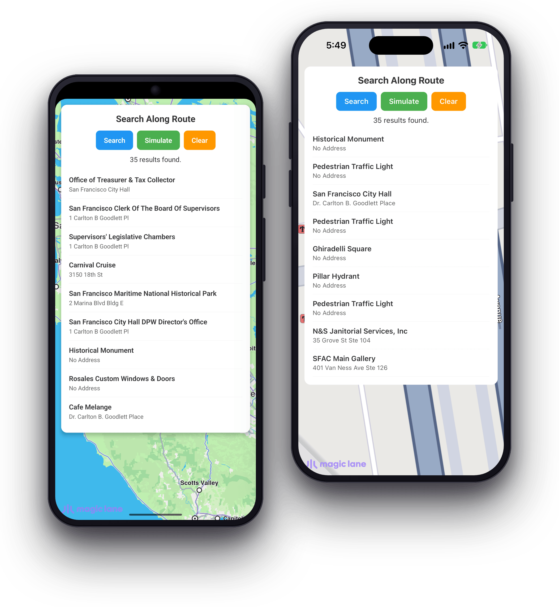

# Search Along Route (React Native)

This app builds a route, searches for landmarks along the main route, lists
them, and can simulate navigation along the route.



## What it demonstrates

- Calculating a route with `RoutingService.calculateRoute` and displaying it with `map.preferences.routes` + `map.centerOnRoutes`.
- Searching along the main route with `SearchService.searchAlongRoute` and highlighting a selected result.
- Simulating navigation with `NavigationService.startSimulation` and following the position, with cancel/clear/stop controls.

The SDK calls are identical to the web example; the only platform difference is
that the map is hosted by the `<GLView>` component instead of a DOM element, and
the chrome (buttons, inputs, result lists) is built from React Native views.

## API token

The map renders without a token (with a watermark); a valid token from [developer.magiclane.com](https://developer.magiclane.com) removes the watermark and unlocks full online functionality. Set it in `App.tsx`:

```ts
const GEMKIT_TOKEN = '<your token>';
```

## Run

Install dependencies first:

```sh
npm install
```

### Android

```sh
npm run android
```

The app is built for the `arm64-v8a` architecture.

To run it on an emulator on a computer with an Intel or AMD processor, which
uses x86_64 system images, add `"x86_64"` to `abiFilters` in
`android/app/build.gradle`:

```groovy
abiFilters "arm64-v8a", "x86_64"
```

### iOS

```sh
cd ios && bundle install && LANG=en_US.UTF-8 LC_ALL=en_US.UTF-8 bundle exec pod install && cd ..
npm run ios
```
