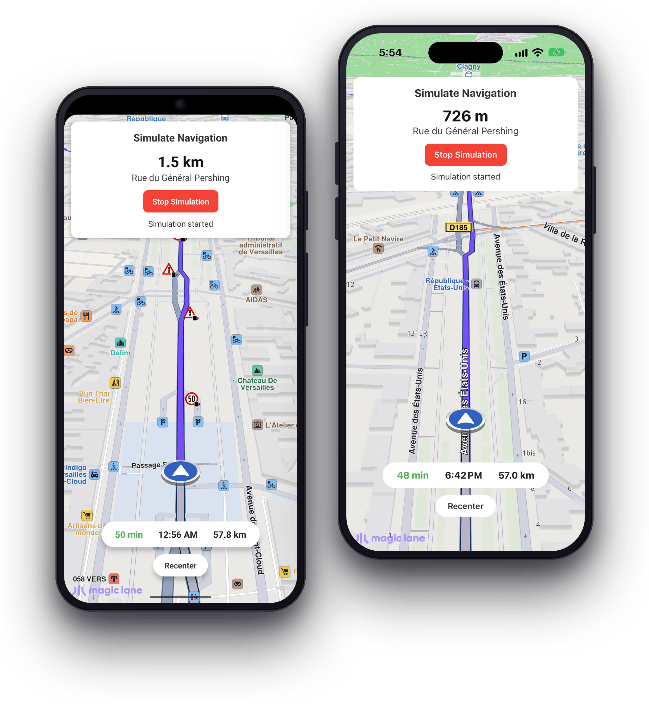

# Simulate Navigation (React Native)

This app builds a Paris-area route (tap an alternative to select it), simulates
navigation along the main route, and shows the live instruction plus a time /
ETA / distance bottom panel with a Recenter button.



## What it demonstrates

- Calculating a route with `RoutingService.calculateRoute`.
- Simulating guidance with `NavigationService.startSimulation(route, undefined,
  { onNavigationInstruction, onError })` and cancelling with
  `NavigationService.cancelNavigation(handler)`.
- Reading `NavigationInstruction` fields (`timeDistanceToNextTurn`,
  `remainingTravelTimeDistance`, `nextStreetName`).
- Selecting an alternative route by tapping it, and keeping the camera on the
  vehicle with `map.startFollowingPosition()`.

The SDK calls are identical to the web example; the only platform difference is
that the map is hosted by the `<GLView>` component instead of a DOM element.

## API token

The map renders without a token (with a watermark). A token from
[developer.magiclane.com](https://developer.magiclane.com) removes the watermark
and unlocks full functionality. Set it in `App.tsx`:

```ts
const GEMKIT_TOKEN = '<your token>';
```

## Run

Install dependencies first:

```sh
npm install
```

### Android

```sh
npm run android
```

The app is built for the `arm64-v8a` architecture.

To run it on an emulator on a computer with an Intel or AMD processor, which
uses x86_64 system images, add `"x86_64"` to `abiFilters` in
`android/app/build.gradle`:

```groovy
abiFilters "arm64-v8a", "x86_64"
```

### iOS

```sh
cd ios && bundle install && LANG=en_US.UTF-8 LC_ALL=en_US.UTF-8 bundle exec pod install && cd ..
npm run ios
```

## Notes

- `GLView` fills the whole window; panels float on top inside `SafeAreaView`
  overlays with `pointerEvents="box-none"`.
- The web demo draws the maneuver icon via `instruction.getNextTurnImage()`; this
  app shows the turn distance and street name as text instead.
