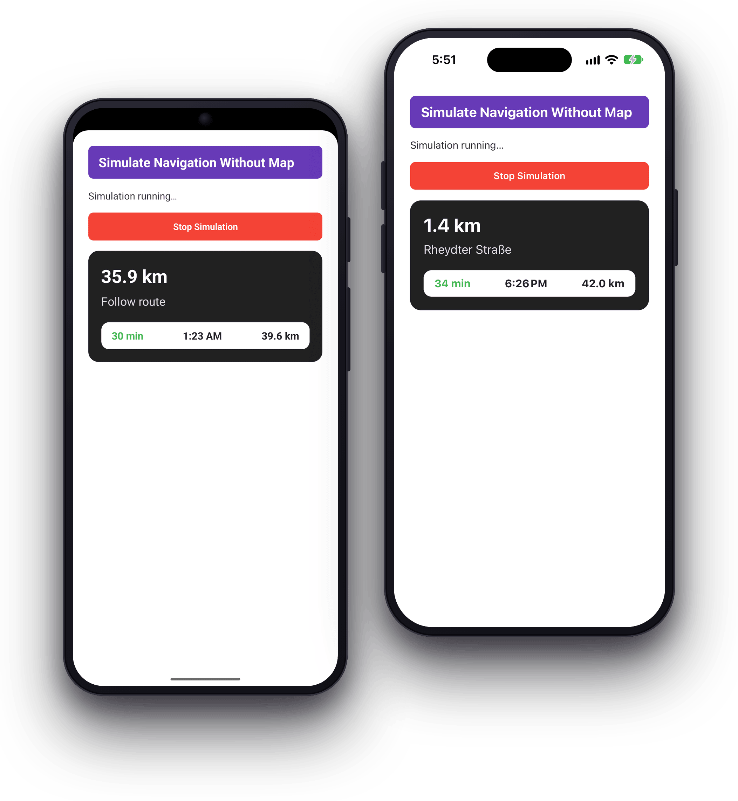

# Simulate Navigation Without Map (React Native)

This app runs the routing + navigation engine **headless** - there is no map
view. The app calculates a Düsseldorf → Cologne route, simulates navigation
along it, and renders the live instruction as text only.



## What it demonstrates

- Initializing the SDK **without a map view**: because no `<GLView>` hosts the
  engine, the app awaits
  `MagicLaneReactNativeSDK.init({authorization: GEMKIT_TOKEN})` before using
  the SDK.
- Calculating a route with `RoutingService.calculateRoute`.
- Simulating guidance with `NavigationService.startSimulation(route, undefined,
  { onNavigationInstruction, onError })`.
- Reading `NavigationInstruction` fields (`timeDistanceToNextTurn`,
  `remainingTravelTimeDistance`, `nextStreetName`) and showing them as text.

This is the one routing example with **no `GLView`** - it proves the engine runs
independently of any rendering surface.

## API token

A token is not required to run the headless engine, but one from
[developer.magiclane.com](https://developer.magiclane.com) unlocks full
functionality. Set it in `App.tsx`:

```ts
const GEMKIT_TOKEN = '<your token>';
```

## Run

Install dependencies first:

```sh
npm install
```

### Android

```sh
npm run android
```

The app is built for the `arm64-v8a` architecture.

To run it on an emulator on a computer with an Intel or AMD processor, which
uses x86_64 system images, add `"x86_64"` to `abiFilters` in
`android/app/build.gradle`:

```groovy
abiFilters "arm64-v8a", "x86_64"
```

### iOS

```sh
cd ios && bundle install && LANG=en_US.UTF-8 LC_ALL=en_US.UTF-8 bundle exec pod install && cd ..
npm run ios
```
