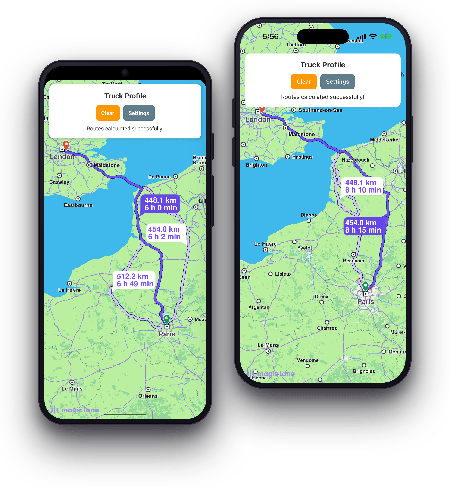

# Truck Profile (React Native)

This app calculates a truck route (Paris → London) using an adjustable
`TruckProfile` (height, length, width, axle load, max speed, total weight) and
draws it on the map. Tapping an alternative route makes it the main route.



## What it demonstrates

- Configuring vehicle dimensions with
  `new RoutePreferences({ transportMode: RouteTransportMode.lorry, truckProfile: new TruckProfile({ height, length, width, axleLoad, maxSpeed, mass }) })`.
  The truck profile only applies with the `lorry` transport mode, and
  `maxSpeed` is in m/s (the stepper's km/h value is divided by 3.6).
- Calculating / cancelling the route with `RoutingService.calculateRoute` and
  `RoutingService.cancelRoute`.
- Displaying routes with `map.preferences.routes.add(...)` and framing them with
  `map.centerOnRoutes({ routes })`.
- Selecting an alternative route by tapping it on the map.

The SDK calls match the web example; the map is hosted by the `<GLView>`
component instead of a DOM element. The web example passes `maxSpeed` in km/h and
leaves the transport mode at its default (car); this app fixes both.

## Dimension controls

React Native has no built-in slider component, so the web demo's settings-sidebar
sliders become numeric **steppers** (−/+). Adjust the values, then build the route
to apply them.

## API token

The map renders without a token (with a watermark). A token from
[developer.magiclane.com](https://developer.magiclane.com) removes the watermark
and unlocks full functionality. Set it in `App.tsx`:

```ts
const GEMKIT_TOKEN = '<your token>';
```

## Run

Install dependencies first:

```sh
npm install
```

### Android

```sh
npm run android
```

The app is built for the `arm64-v8a` architecture.

To run it on an emulator on a computer with an Intel or AMD processor, which
uses x86_64 system images, add `"x86_64"` to `abiFilters` in
`android/app/build.gradle`:

```groovy
abiFilters "arm64-v8a", "x86_64"
```

### iOS

```sh
cd ios && bundle install && LANG=en_US.UTF-8 LC_ALL=en_US.UTF-8 bundle exec pod install && cd ..
npm run ios
```

## Notes

- `GLView` fills the whole window; the controls and settings panel float on top
  inside `SafeAreaView` overlays with `pointerEvents="box-none"`.
