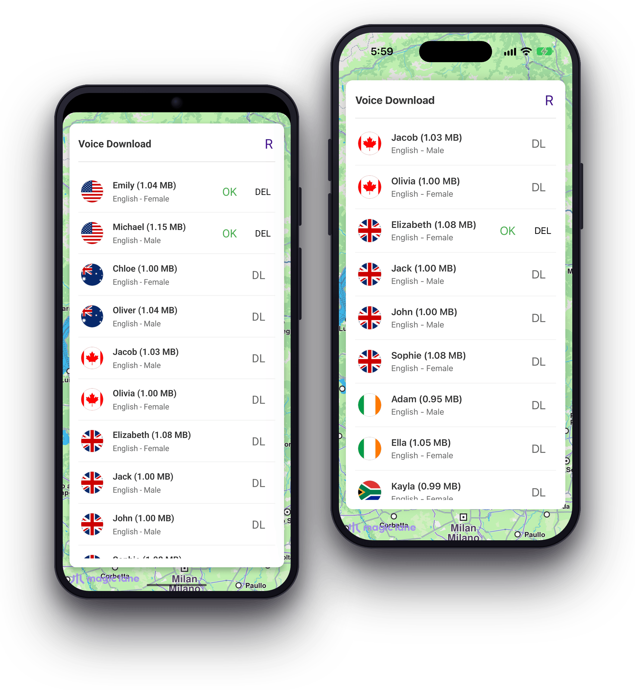

# Voice Download (React Native)

This app lists the human voices available in the content store and lets you
download, pause, resume and delete them.



## What it demonstrates

- Initializing the SDK with `MagicLaneReactNativeSDK.init({authorization})` and
  allowing content downloads on metered networks with
  `SdkSettings.setAllowOffboardServiceOnExtraChargedNetwork`.
- Fetching the voices list with
  `ContentStore.asyncGetStoreContentList(ContentType.humanVoice, ...)`.
- Downloading a voice with `ContentStoreItem.asyncDownload` and showing its
  progress; pausing it with `pauseDownload` and removing it with `deleteContent`.
- Making a downloaded voice the current voice with
  `SdkSettings.setVoiceByPath(item.fileName)`.
- Showing each voice's country flag from `MapDetails.getCountryFlag`, converted
  with `MagicLaneHelper.convertUint8ArrayToBase64`.

Tap a voice to start its download, tap it again to pause, and tap a paused voice
to resume. When a download finishes, that voice becomes the current one. A
downloaded voice shows a **DEL** button to remove it. **R** reloads the list.

## API token

The map renders without a token (with a watermark), but **downloading voices
requires a valid token** from
[developer.magiclane.com](https://developer.magiclane.com) and an internet
connection. Set it in `App.tsx`:

```ts
const GEMKIT_TOKEN = '<your token>';
```

## Run

Install dependencies first:

```sh
npm install
```

### Android

```sh
npm run android
```

The app is built for the `arm64-v8a` architecture.

To run it on an emulator on a computer with an Intel or AMD processor, which
uses x86_64 system images, add `"x86_64"` to `abiFilters` in
`android/app/build.gradle`:

```groovy
abiFilters "arm64-v8a", "x86_64"
```

### iOS

```sh
cd ios && bundle install && LANG=en_US.UTF-8 LC_ALL=en_US.UTF-8 bundle exec pod install && cd ..
npm run ios
```
